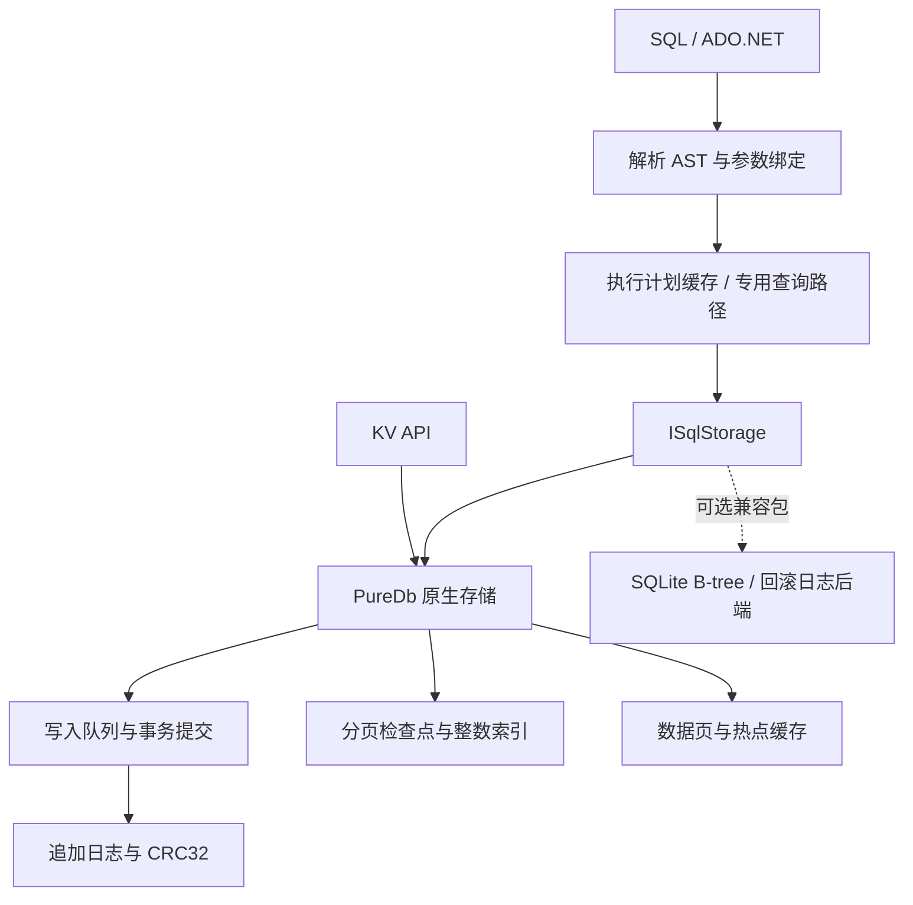

# PureDb — 纯 .NET 10 文件数据库

[](https://github.com/hnlyf168/PureDb/actions/workflows/ci.yml)
[](https://www.nuget.org/packages/PureDb)
[](LICENSE)

PureDb 使用 C# 和 .NET 10 标准库实现嵌入式数据库，提供 KV、SQL、JOIN、JSON、事务、多线程写入、多进程访问和 ADO.NET。核心与可选 SQLite 文件兼容库均无原生库和第三方 NuGet 依赖。

**当前版本：`1.0.0-preview.1`。** 这是首个公开预览版。SQL、文件协议和事务能力有明确边界；当前没有在所有性能、CPU、内存指标上超过 SQLite。

[安装与使用](docs/USAGE.md) · [ADO.NET](docs/ADO.NET.md) · [SQLite 文件兼容](docs/SQLITE-COMPATIBILITY.md) · [全面性能表](docs/PERFORMANCE.md) · [CPU / 内存谁更高](docs/RESOURCES.md) · [可筛选性能面板](docs/PERFORMANCE.html) · [原始结果](benchmarks/results/latest) · [自动发布](docs/RELEASING.md)

开发分支 `1.0.0-preview.2` 新增：[C# 用户函数注入](docs/USER-FUNCTIONS.md)、[中文注释与代码规范](docs/CODE-STYLE.md)。开发版尚未发布；[扩展进度](docs/FEATURE-WORK.md) 单独记录，下面的版本矩阵与性能实测仍对应已发布的 `1.0.0-preview.1`。

## 安装

```bash
dotnet add package PureDb --version 1.0.0-preview.1
# 需要原地读取/修改受支持的 SQLite 文件时额外安装：
dotnet add package PureDb.SqliteCompatibility --version 1.0.0-preview.1
```

```csharp
using PureDb;

await using var db = new SqlDatabase("app.pdb");
await db.ExecuteAsync("CREATE TABLE IF NOT EXISTS users(id INTEGER PRIMARY KEY,name TEXT NOT NULL,profile JSON)");
await db.ExecuteAsync("INSERT INTO users VALUES(@id,@name,@profile)",
    new Dictionary<string, object?>
    {
        ["id"] = 1L, ["name"] = "小明", ["profile"] = "{\"age\":25}"
    });
var result = db.Query("SELECT name,json_extract(profile,'$.age') AS age FROM users WHERE id=@id",
    new Dictionary<string, object?> { ["id"] = 1L });
Console.WriteLine(result.Rows[0][0]);
```

KV 使用 `Database`，SQL 使用 `SqlDatabase`，各自使用独立文件。SQL 表需要 `INTEGER PRIMARY KEY`，主键范围 `[0, 2^40)`。

## 与 SQLite 功能对比

基准：PureDb `1.0.0-preview.1` / SQLite `3.54.1`。✅ 已实现，⚠️ 有限制或需额外组件，❌ 尚未实现。功能标记表示支持范围，不表示相同的实现、成熟度或性能。

| 功能 | PureDb | SQLite |
| :--- | :--- | :--- |
| 纯 .NET、无原生依赖 | ✅ 核心和兼容库均为托管 C# | ⚠️ 原版为 C 内核，.NET 通常通过原生绑定使用 |
| 嵌入式文件数据库 | ✅ 自有追加日志及索引侧文件 | ✅ SQLite 数据文件及可选日志侧文件 |
| KV / SQL API | ✅ 独立 KV 与 SQL API | ⚠️ 通过 SQL 表实现 KV |
| 参数化 SQL、增删改查 | ✅ 支持的 SQL 子集 | ✅ 更完整的 SQL 方言 |
| INNER / LEFT / RIGHT / FULL / CROSS JOIN | ✅ 哈希查找或通用循环执行 | ✅ 支持 |
| GROUP BY / HAVING / ORDER BY / LIMIT | ✅ 支持 | ✅ 支持 |
| 普通、唯一、JSON 路径索引 | ✅ 单列及指定表达式 | ✅ 支持更多索引形态 |
| 复合索引、外键、视图、触发器 | ❌ 尚未实现 | ✅ 支持 |
| CTE、窗口函数、子查询、UNION | ❌ 尚未实现 | ✅ 支持 |
| JSON 文本、路径查询与修改 | ✅ 已实现函数及路径子集 | ✅ JSON 函数及操作符 |
| JSONB | ⚠️ 自有 PJB1 格式，与 SQLite JSONB 不互通 | ✅ SQLite 自有 JSONB 格式 |
| JSON5 / json_each / json_tree | ❌ 尚未实现 | ✅ 支持 |
| 批量新增、更新、删除 | ✅ 单事务多操作、区间 DML | ✅ 事务及 SQL 批处理 |
| 多线程写入 | ✅ 有界队列、单写入者、分组刷盘 | ✅ 多连接协调，写事务串行 |
| 多进程访问 | ✅ 原生格式 Shared 模式 | ✅ 文件锁；WAL 支持并发读取 |
| ADO.NET | ✅ 内置 Connection / Command / Reader / Transaction | ⚠️ 使用 Microsoft.Data.Sqlite 等额外提供程序 |
| 事务 | ⚠️ SQL 调用原子提交；ADO.NET 乐观 Serializable | ✅ BEGIN / COMMIT / ROLLBACK 等 |
| SAVEPOINT / 完整 SQLite 事务语法 | ❌ 尚未实现 | ✅ 支持 |
| 启动恢复、校验、压缩 | ✅ 检查点、CRC32、日志恢复、Compact | ✅ 日志恢复、integrity_check、VACUUM |
| 原地读写 SQLite 文件 | ⚠️ 可选纯 .NET 兼容包；UTF-8 / 4096 页 / 独占回滚日志子集 | ✅ 原生完整协议 |
| SQLite WAL 文件协议兼容 | ❌ 兼容包拒绝 WAL | ✅ 支持 |
| 跨平台验证 | ✅ Windows x64、Linux ARM64 | ✅ 多平台 |

SQLite 能力依据官方 [SQL 文档](https://www.sqlite.org/lang.html)、[JSON 文档](https://www.sqlite.org/json1.html)、[WAL 文档](https://www.sqlite.org/wal.html)；其 .NET 提供程序见 [Microsoft.Data.Sqlite](https://learn.microsoft.com/en-us/dotnet/standard/data/sqlite/)。PureDb 的具体约束见 [使用文档](docs/USAGE.md)。

## 与 SQLite 性能对比

<!-- PERFORMANCE:START -->

最新预览版原生格式 vs SQLite 3.54.1，同机三轮中位数。CPU 为满吞吐进程占用，内存为单库独立测量。使用率高不代表每次查询更费 CPU。以下是代表场景，全部 41 项、ADO、CPU 和文件数据见完整报告。

| 平台 | PureDb 耗时胜 | SQLite 耗时胜 | 接近 |
| --- | --- | --- | --- |
| Windows x64 | 31 | 7 | 3 |
| Linux ARM64 | 25 | 16 | 0 |

### Windows x64

| 项目 | PureDb | SQLite | 谁更低 |
| --- | --- | --- | --- |
| SQL 主键完整行（µs/queries） | 0.354 | 5.442 | 🟩 PureDb 15.38× |
| SQL 范围 20 行（µs/queries） | 2.771 | 14.653 | 🟩 PureDb 5.29× |
| INNER JOIN（µs/queries） | 1.159 | 10.213 | 🟩 PureDb 8.81× |
| JSON 表达式索引（µs/queries） | 2.357 | 20.775 | 🟩 PureDb 8.81× |
| JSON 整数取余计数（µs/queries） | 3.641 | 492.273 | 🟩 PureDb 135.20× |
| Full 逐条新增（µs/rows） | 23,598.465 | 25,021.599 | 🟩 PureDb 1.06× |
| Full 逐条更新（µs/rows） | 25,221.880 | 24,063.731 | 🟨 接近 |
| Full 逐条删除（µs/rows） | 28,646.337 | 21,991.937 | 🟥 SQLite 1.30× |
| Full 批量新增（µs/rows） | 37.403 | 34.074 | 🟥 SQLite 1.10× |
| Full 批量更新（µs/rows） | 28.976 | 41.536 | 🟩 PureDb 1.43× |
| Full 批量删除（µs/rows） | 24.862 | 43.214 | 🟩 PureDb 1.74× |
| Buffered 批量新增（µs/rows） | 1.216 | 1.714 | 🟩 PureDb 1.41× |
| Buffered 批量更新（µs/rows） | 1.897 | 24.513 | 🟩 PureDb 12.92× |
| Buffered 批量删除（µs/rows） | 1.352 | 22.452 | 🟩 PureDb 16.61× |
| 四进程读取（µs/queries） | 25.435 | 13.656 | 🟥 SQLite 1.86× |
| 四进程原子更新（µs/updates） | 208.144 | 113.001 | 🟥 SQLite 1.84× |
| 重开并首次范围查询（µs/opens） | 623.820 | 629.320 | 🟨 接近 |

| 内存场景 | PureDb RSS MiB | SQLite RSS MiB | 谁更高、高多少 |
| --- | --- | --- | --- |
| point | 86.87 | 78.76 | **PureDb 更高**：多 8.11 MiB，高 10.3% |
| range | 56.00 | 56.49 | **SQLite 更高**：多 0.49 MiB，高 0.9% |
| json | 57.78 | 45.46 | **PureDb 更高**：多 12.32 MiB，高 27.1% |

| 主键查询 CPU 指标 | PureDb | SQLite | 谁更高、高多少 |
| --- | --- | --- | --- |
| 占整机 CPU % | 8.507 | 8.333 | **PureDb 更高**：多 0.174 个百分点，高 2.1% |
| 每次查询 CPU µs | 0.361 | 5.442 | **SQLite 更高**：多 5.081 µs，高 1406.6% |

### Linux ARM64

| 项目 | PureDb | SQLite | 谁更低 |
| --- | --- | --- | --- |
| SQL 主键完整行（µs/queries） | 0.952 | 3.586 | 🟩 PureDb 3.77× |
| SQL 范围 20 行（µs/queries） | 6.542 | 19.422 | 🟩 PureDb 2.97× |
| INNER JOIN（µs/queries） | 5.565 | 12.184 | 🟩 PureDb 2.19× |
| JSON 表达式索引（µs/queries） | 5.961 | 30.270 | 🟩 PureDb 5.08× |
| JSON 整数取余计数（µs/queries） | 12.621 | 668.860 | 🟩 PureDb 53.00× |
| Full 逐条新增（µs/rows） | 2,445.134 | 1,271.681 | 🟥 SQLite 1.92× |
| Full 逐条更新（µs/rows） | 819.842 | 964.580 | 🟩 PureDb 1.18× |
| Full 逐条删除（µs/rows） | 1,057.950 | 899.698 | 🟥 SQLite 1.18× |
| Full 批量新增（µs/rows） | 37.841 | 16.340 | 🟥 SQLite 2.32× |
| Full 批量更新（µs/rows） | 32.937 | 12.878 | 🟥 SQLite 2.56× |
| Full 批量删除（µs/rows） | 13.077 | 9.523 | 🟥 SQLite 1.37× |
| Buffered 批量新增（µs/rows） | 11.059 | 7.665 | 🟥 SQLite 1.44× |
| Buffered 批量更新（µs/rows） | 13.558 | 11.436 | 🟥 SQLite 1.19× |
| Buffered 批量删除（µs/rows） | 9.542 | 7.743 | 🟥 SQLite 1.23× |
| 四进程读取（µs/queries） | 53.665 | 29.495 | 🟥 SQLite 1.82× |
| 四进程原子更新（µs/updates） | 319.900 | 54.381 | 🟥 SQLite 5.88× |
| 重开并首次范围查询（µs/opens） | 1,263.260 | 387.040 | 🟥 SQLite 3.26× |

| 内存场景 | PureDb RSS MiB | SQLite RSS MiB | 谁更高、高多少 |
| --- | --- | --- | --- |
| point | 98.05 | 76.86 | **PureDb 更高**：多 21.19 MiB，高 27.6% |
| range | 68.48 | 57.43 | **PureDb 更高**：多 11.06 MiB，高 19.3% |
| json | 74.50 | 50.39 | **PureDb 更高**：多 24.11 MiB，高 47.8% |

| 主键查询 CPU 指标 | PureDb | SQLite | 谁更高、高多少 |
| --- | --- | --- | --- |
| 占整机 CPU % | 13.682 | 12.532 | **PureDb 更高**：多 1.149 个百分点，高 9.2% |
| 每次查询 CPU µs | 1.042 | 3.602 | **SQLite 更高**：多 2.560 µs，高 245.7% |

<!-- PERFORMANCE:END -->

🟩 PureDb 更低，🟥 SQLite 更低，🟨 差距小于 5%。**耗时、CPU 时间、驻留内存分别评判。** KV 对 SQL、纯 SQL 对 SQL、ADO.NET 对 SQLite C API 的接口差异在报告中单独说明。热缓存与重复聚合的优势不能外推到所有业务。

## 原理、实现思路与技术

### 1. 分层：SQL 与存储引擎解耦



核心项目包含原生存储、SQL 和 ADO.NET。`PureDb.SqliteCompatibility` 单向依赖核心，实现同一存储抽象，核心不依赖兼容库。默认创建的是 PureDb 文件；只有显式使用兼容入口才处理 SQLite 文件。

### 2. 存储：追加日志、校验与分页检查点

提交将变更编码为事务帧，记录长度、长度反码、CRC32 和操作列表，顺序追加到日志。值留在磁盘，主键索引保存值的位置、长度及校验信息。追加设计减少原地随机修改，但会累积旧版本，需要压缩回收。

主索引由分页持久化检查点、内存增量与有界热点页组成。有效检查点存在时，打开只读元数据，再恢复检查点之后的日志尾部；检查点缺失或失效则扫描重建。数据库变大不要求每次都加载全部数据，但恢复尾部、重建和完整校验仍可能与数据量相关。整数 SQL 索引也以页为单位延迟读取。

默认按访问验证索引页和数据值的 CRC。覆盖索引只访问索引时，不会同时扫描未请求的数据负载；`VerifyOnOpen` / `VerifyIntegrity` 用于完整校验。校验和用于发现损坏，不等同于纠错。

源码：[原生引擎](src/PureDb/Database.cs)、[主索引与检查点](src/PureDb/Database.Checkpoint.cs)、[分页索引](src/PureDb/DiskIndex.cs)。

### 3. 写入：有界队列、批量事务与分组提交

Full 写入通过 `Channel` 有界队列进入单写入者，合并一组请求的日志写入与刷盘，分别保留事务边界，并在确认前完成刷盘。一个批次包含多条变更时，共享编码、提交和同步成本。Buffered SQL 可以在调用线程提交，减少队列往返，但它和 SQLite WAL/NORMAL 的 checkpoint、关闭及断电行为不同。

`ReaderWriterLockSlim` 协调实例内访问；Shared 模式使用命名 Mutex、协调戳内存映射及日志追赶处理多进程更新。协调戳是缓存提示，日志与代际校验才是恢复依据。写入仍然串行，更多线程不保证线性加速。

源码：[写入与恢复](src/PureDb/Database.cs)、[SQL 事务](src/PureDb/Sql/SqlTransactionSession.cs)。

### 4. 查询：识别常见形状，减少通用执行开销

SQL 先解析成 AST，再缓存参数绑定、列投影和受支持的执行计划。主键查询直接定位记录；只投影主键时可使用覆盖索引。整数范围查询以精确二分为基础，增加经过实际键验证的估算探测；偏斜或不适合的分布保留精确查找。小 LIMIT 验证最后候选键后，减少另一端边界搜索和读页。

区间 UPDATE / DELETE 直接读取目标范围，避免先解码整表；没有 UNIQUE 约束时省去约束集合。通用谓词和不支持的优化形状走通用执行器，不能把专用路径的倍率当作所有 SQL 的速度。

源码：[查询分派](src/PureDb/Sql/SqlQuery.cs)、[范围查询](src/PureDb/Sql/SqlDiskRange.cs)、[区间 DML](src/PureDb/Sql/SqlDmlPlan.cs)。

### 5. JOIN、聚合、JSON 与 SIMD

等值 JOIN 可使用缓存哈希查找及直接投影，其他形状保留通用循环。无过滤 COUNT 使用维护的精确计数；分组计数可复用按数据版本生成的统计与排序结果。写入后会失效或重建，缓存有内存和首次建立成本。

JSON 路径及解析结果可复用；整数派生列采用连续数组，对受支持的“正的 2 次幂取余等于零”计数使用 `System.Numerics.Vector<long>` 位运算，保留 NULL 和负数语义。其他条件走标量或通用路径。CRC32 同样有硬件/向量路径与回退。硬件通道数不等于实测加速倍率。

PureDb 在部分用例比 SQLite 快，主要来自这些专用路径、版本化缓存和减少物化工作；SQLite 也使用索引和字节码执行。本项目同时保存参测 SQLite 的 EXPLAIN 计划，避免把优势误解成“SQLite 没有索引”。

源码：[JOIN](src/PureDb/Sql/SqlJoinPlan.cs)、[聚合](src/PureDb/Sql/SqlAggregate.cs)、[SIMD 计数](src/PureDb/Sql/SqlDerivedCount.cs)、[JSON](src/PureDb/Sql/SqlJson.cs)、[CRC](src/PureDb/Crc32.Vectorized.cs)。

### 6. 内存、ADO.NET 和兼容模式的边界

数据页缓存默认 64 MiB，SQL 行缓存另有 64 MiB 估算预算，索引、执行计划、结果和运行时还有额外占用，不能把缓存预算当成进程内存上限。BLOB 返回独立副本；数据和模式版本决定缓存何时失效。当前内存占用仍有弱于 SQLite 的场景。

ADO.NET 提供 Connection、Command、Parameter、DataReader、DbTransaction 和 ProviderFactory。事务使用带冲突检测的乐观 Serializable；调用方需要处理冲突重试。ADO.NET 兼容不等于已兼容所有 ORM 及完整 SQLite SQL。

兼容包实现 SQLite B-tree 页、record 编码、overflow 和回滚日志子集；仅允许声明的格式及独占使用方式。默认写入可能重建整库，实验增量更新只覆盖特定页内修改，其他情况回退。WAL、未知模式和未实现协议明确拒绝。详细限制见 [兼容文档](docs/SQLITE-COMPATIBILITY.md)。

## 构建、验证与复现

需要 .NET SDK `10.0.402`。核心无第三方包，`NuGet.Config` 可离线恢复。SQLite 原生库仅用于测试和对比，不进入发布包。

```bash
dotnet build PureDb.slnx -c Release
python scripts/prepare-sqlite.py
python scripts/test.py
# 创建 10 万行数据集，然后以程序输出的目录运行：
dotnet run -c Release --no-build --project benchmarks/PureDb.QueryBenchmarks -- 100000 1
python scripts/run-benchmarks.py artifacts/new-comparison DATASET --tests --memory --ado
```

CI 在 Windows / Linux 上构建并运行回归和 SQLite 差分查询；性能测量按主机串行进行。仓库只保存 [最新一份对比证据](benchmarks/results/latest)，不保存历史轮次、测试数据库或运行库二进制。复现细节见 [基准方法](docs/BENCHMARKS.md)。

## 自动发布与许可

推送 `v1.0.0-preview.1` 等预览标签后，[发布流水线](.github/workflows/publish.yml) 会校验版本、执行 Windows / Linux 测试、打包两个纯 .NET 包、发布至 NuGet 并创建 GitHub 预发布。仓库需要配置 Actions Secret `NUGET_API_KEY`；失败的任务会停止后续发布。NuGet 的两个包独立接收上传，跨包发布不具有原子性。详见 [发布说明](docs/RELEASING.md)。

项目采用 [MIT](LICENSE)。CRC 向量实现的来源和版权声明见 [第三方声明](THIRD-PARTY-NOTICES.md)。
