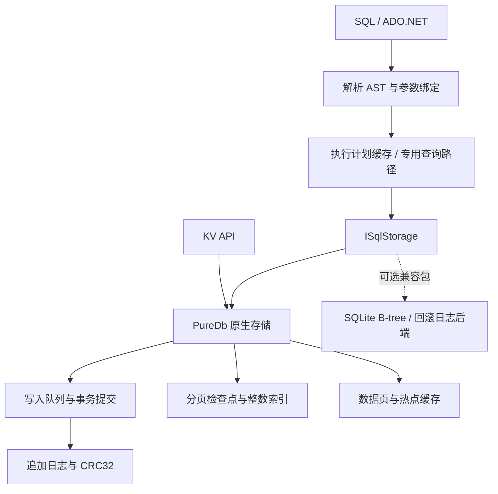

# PureDb — 纯 .NET 10 文件数据库

[](https://github.com/donet-org-cn/PureDb/actions/workflows/ci.yml)
[](https://www.nuget.org/packages/PureDb)
[](LICENSE)

PureDb 使用 C# 和 .NET 10 标准库实现嵌入式数据库，提供 KV、SQL、JOIN、JSON、事务、多线程写入、多进程访问和 ADO.NET。核心与可选 SQLite 文件兼容库均无原生库和第三方 NuGet 依赖。

**当前候选版：`1.0.0-rc.1`，主库与可选兼容包版本一致。** 本版重点处理大库主键范围、检查点内存回收、半开区间增删改、压缩关闭与一致快照备份，并修复大整数、IS 和位运算兼容性。当前没有在所有性能、CPU、内存指标上超过 SQLite，也不以候选版标签替代生产验证。

[SQL 支持与不支持清单](docs/SQL-SUPPORT.md) · [安装与使用](docs/USAGE.md) · [ADO.NET](docs/ADO.NET.md) · [SQLite 文件兼容](docs/SQLITE-COMPATIBILITY.md) · [当前 41 项与 CPU / RSS](docs/RC-PERFORMANCE.md) · [十万 / 百万行及文件大小](docs/SCALE-PERFORMANCE.md) · [正式发布评估](docs/PRODUCTION-READINESS.md) · [当前原始结果](benchmarks/results/candidate/latest) · [自动发布](docs/RELEASING.md)

主分支已包含 **复合索引、外键、CHECK、UPSERT、视图、行触发器、CTE、窗口、相关子查询、集合运算、JSON5 / JSON 表函数、SQL 事务和保存点**，以及 C# 用户函数和中文 XML 注释。边界见 [SQL 清单](docs/SQL-SUPPORT.md)。当前 41 项及十万 / 百万行对照均使用同一冻结 DLL 在 Windows x64、Linux ARM64 重测；已有排序和 AOT 部署体积专项明确保留 preview.3 版本标签。

## 安装

安装已发布的 NuGet 版本：

```bash
dotnet add package PureDb --version 1.0.0-rc.1
# 需要原地读取/修改受支持的 SQLite 文件时额外安装：
dotnet add package PureDb.SqliteCompatibility --version 1.0.0-rc.1
```

也可从 `main` 构建源码；构建及本地打包命令见文末。两个包的版本统一由 [Directory.Build.props](Directory.Build.props) 定义，变更见 [CHANGELOG](CHANGELOG.md)。

```csharp
using PureDb;

await using var db = new SqlDatabase("app.pdb");
await db.ExecuteAsync("CREATE TABLE IF NOT EXISTS users(id INTEGER PRIMARY KEY,name TEXT NOT NULL,profile JSON)");
await db.ExecuteAsync("INSERT INTO users VALUES(@id,@name,@profile)",
    new Dictionary<string, object?>
    {
        ["id"] = 1L, ["name"] = "小明", ["profile"] = "{\"age\":25}"
    });
var result = db.Query("SELECT name,json_extract(profile,'$.age') AS age FROM users WHERE id=@id",
    new Dictionary<string, object?> { ["id"] = 1L });
Console.WriteLine(result.Rows[0][0]);
```

KV 使用 `Database`，SQL 使用 `SqlDatabase`，各自使用独立文件。SQL 表需要 `INTEGER PRIMARY KEY`，主键范围 `[0, 2^40)`。

可以将 C# 方法注册为 SQL 标量函数，`SqlDatabase` 和 ADO.NET 连接都提供相同入口：

```csharp
db.CreateFunction<string?, bool>("RELIGIBLE", user => user is "Alice" or "小明");
var eligible = db.Query("SELECT * FROM users WHERE RELIGIBLE(name)");
```

函数按连接、名称和参数数量注册，可替换或移除。强类型入口直接调用委托，布尔结果复用 SQL 0/1 对象，省去逐行参数数组和布尔装箱；NULL、BLOB 复制和业务异常仍经过边界检查。使用方法及限制见 [用户函数](docs/USER-FUNCTIONS.md)。

## 与 SQLite 功能对比

基准：PureDb `1.0.0-rc.1` **候选版** / SQLite `3.54.1`。✅ 已实现，⚠️ 有限制或需额外组件，❌ 尚未实现。功能标记表示支持范围，不表示相同的实现、成熟度或性能。

| 功能 | PureDb | SQLite |
| :--- | :--- | :--- |
| 纯 .NET、无原生依赖 | ✅ 核心和兼容库均为托管 C# | ⚠️ 原版为 C 内核，.NET 通常通过原生绑定使用 |
| 嵌入式文件数据库 | ✅ 自有追加日志及索引侧文件 | ✅ SQLite 数据文件及可选日志侧文件 |
| KV / SQL API | ✅ 独立 KV 与 SQL API | ⚠️ 通过 SQL 表实现 KV |
| 参数化 SQL、增删改查 | ✅ 支持的 SQL 子集 | ✅ 更完整的 SQL 方言 |
| INNER / LEFT / RIGHT / FULL / CROSS JOIN | ✅ 哈希查找或通用循环执行 | ✅ 支持 |
| GROUP BY / HAVING / ORDER BY / LIMIT | ✅ 支持 | ✅ 支持 |
| 应用自定义 SQL 函数 | ⚠️ C# 标量函数、强类型和可变参数入口；自定义聚合、窗口和表值函数尚未实现 | ✅ 标量、聚合、窗口及表值扩展接口 |
| 普通、唯一、JSON 路径索引 | ✅ 单列及指定表达式 | ✅ 支持更多索引形态 |
| 复合索引 | ⚠️ 左前缀、范围、混合排序及唯一性；定义持久化，数据惰性内存构建 | ✅ 支持分页增量索引 |
| CHECK / UPSERT | ⚠️ 列级及表级 CHECK；单分支冲突插入或更新，详细边界见 SQL 清单 | ✅ 支持更完整冲突语法 |
| 外键、视图、触发器 | ⚠️ 外键五种动作及延迟校验、普通视图、行触发器；受支持模式也可写入 SQLite 文件 | ✅ 支持更多模式及控制选项 |
| CTE、窗口函数、子查询、集合 | ⚠️ 普通/受控递归 CTE、排名/偏移/聚合窗口、相关子查询、UNION/INTERSECT/EXCEPT | ✅ 支持更完整语法和优化 |
| JSON 文本、路径查询与修改 | ✅ 已实现函数及路径子集 | ✅ JSON 函数及操作符 |
| JSONB | ⚠️ 自有 PJB1 格式，与 SQLite JSONB 不互通 | ✅ SQLite 自有 JSONB 格式 |
| JSON5 / json_each / json_tree | ⚠️ 已实现；深度 128，节点 ID 与 SQLite 不同 | ✅ 支持 |
| 批量新增、更新、删除 | ✅ 单事务多操作、区间 DML | ✅ 事务及 SQL 批处理 |
| 多线程写入 | ✅ 有界队列、单写入者、分组刷盘 | ✅ 多连接协调，写事务串行 |
| 多进程访问 | ✅ 原生格式 Shared 模式 | ✅ 文件锁；WAL 支持并发读取 |
| ADO.NET | ✅ 内置 Connection / Command / Reader / Transaction | ⚠️ 使用 Microsoft.Data.Sqlite 等额外提供程序 |
| 事务 | ⚠️ BEGIN / COMMIT / END / ROLLBACK；乐观 Serializable，Shared 只支持 DEFERRED | ✅ SQLite 事务及文件锁协议 |
| SAVEPOINT / ROLLBACK TO / RELEASE | ✅ SQL 与 ADO.NET 保存点、DDL 回滚 | ✅ 支持 |
| 完整 SQLite SQL / 类型 / 锁协议 | ❌ 支持子集，完整边界见 SQL 清单 | ✅ 原生实现 |
| 启动恢复、校验、压缩 | ✅ 检查点、CRC32、日志恢复、Compact | ✅ 日志恢复、integrity_check、VACUUM |
| 打开期间一致备份 | ✅ 原生 Backup，只备份已提交前缀，拒绝覆盖目标 | ✅ 官方 backup API |
| 原地读写 SQLite 文件 | ⚠️ 可选纯 .NET 兼容包；八种页大小 / 三种编码 / 受限模式 / 独占回滚日志子集 | ✅ 原生完整协议 |
| SQLite WAL 文件协议兼容 | ❌ 兼容包拒绝 WAL | ✅ 支持 |
| Native AOT | ✅ 核心与纯托管兼容库；Windows x64、Linux x64、Linux ARM64 流水线实际运行 | ⚠️ C 内核可编译为本机代码，.NET 宿主取决于绑定 |
| 跨平台验证 | ✅ Windows x64、Linux ARM64 实测；Linux x64 CI | ✅ 多平台 |

SQLite 能力依据官方 [SQL 文档](https://www.sqlite.org/lang.html)、[自定义函数](https://www.sqlite.org/appfunc.html)、[JSON 文档](https://www.sqlite.org/json1.html)、[WAL 文档](https://www.sqlite.org/wal.html)；其 .NET 提供程序见 [Microsoft.Data.Sqlite](https://learn.microsoft.com/en-us/dotnet/standard/data/sqlite/)。PureDb 的逐类语法、例子、原理和限制见 [SQL 支持清单](docs/SQL-SUPPORT.md)。

## 本轮优化与兼容性验收

原生主键范围不再先扫描全表或创建重复索引；检查点流式写入并释放已持久增量，半开区间同时利用上下界。压缩、关闭、首次查询与热查询分开计时；全部改善及退步见 [十万 / 百万行报告](docs/SCALE-PERFORMANCE.md)。

Windows x64 与 Linux ARM64 分别通过 SQL 固定公开语料 **175 条**、扩展差分 **298 条**及 SQLite 文件正向与恢复 **66 组**，并完成各 **100 万次随机变更**、并发读取、维护强杀和 AOT 验证。Linux 另通过真实部分写入错误恢复。分母与未覆盖能力见 [发布就绪评估](docs/PRODUCTION-READINESS.md)；这不是整体 SQLite 兼容性 95% 的声明。


[博客园独立文章：实现原理、功能对照、真实性能图与限制](docs/CNBLOGS-preview.3.md)。

## preview.3 的 AOT 部署体积参考

rc.1 已重新编译运行 AOT 功能与差分测试，详见发布评估；下表是此前 preview.3 应用宿主的部署体积，保留原版本边界，不作为 rc.1 体积测量。

<!-- AOT:START -->

| 平台 | AOT 运行文件 MiB：PureDb / SQLite | PureDb 全进程启动 ms：JIT → AOT | AOT 耗时：领先 / 落后 / 接近 |
| --- | --- | --- | --- |
| Windows x64 | 6.18 / 5.72 | 225.75 → 34.65 | 13 / 2 / 0 |
| Linux ARM64 | 6.12 / 3.79 | 379.55 → 20.30 | 11 / 4 / 0 |

SQLite 体积包含其原生库；AOT 体积是本次应用发布闭包。详细 CPU、RSS、增删改及方法见 [AOT 完整报告](docs/AOT-PERFORMANCE.md)。

<!-- AOT:END -->

## preview.3 排序专项（历史测量）

<!-- SORT:START -->

10 万行热缓存排序，三轮中位数；数值越低越好。此表对应冻结的 `preview.3` 发布源码，CPU 是每次查询消耗的时间。

| 平台 | 场景 | PureDb 耗时 µs | SQLite 耗时 µs | 耗时谁更低 | PureDb CPU µs | SQLite CPU µs | CPU 谁更低 |
| --- | --- | ---: | ---: | --- | ---: | ---: | --- |
| Windows x64 | 排序取 20 行 | 1,651.101 | 5,425.296 | 🟩 PureDb 3.29× | 1,648.352 | 5,395.683 | 🟩 PureDb 3.27× |
| Windows x64 | 降序取 20 行，跳过 100 行 | 1,831.496 | 6,310.576 | 🟩 PureDb 3.45× | 1,829.268 | 6,433.824 | 🟩 PureDb 3.52× |
| Windows x64 | 排序取 4096 行 | 5,808.618 | 12,520.362 | 🟩 PureDb 2.16× | 5,769.231 | 12,551.230 | 🟩 PureDb 2.18× |
| Windows x64 | 主键范围取 20 行（对照） | 2.090 | 6.857 | 🟩 PureDb 3.28× | 2.046 | 6.850 | 🟩 PureDb 3.35× |
| Linux ARM64 | 排序取 20 行 | 3,143.483 | 8,865.853 | 🟩 PureDb 2.82× | 3,143.502 | 8,867.141 | 🟩 PureDb 2.82× |
| Linux ARM64 | 降序取 20 行，跳过 100 行 | 4,077.483 | 9,284.931 | 🟩 PureDb 2.28× | 4,078.562 | 9,286.074 | 🟩 PureDb 2.28× |
| Linux ARM64 | 排序取 4096 行 | 15,697.873 | 21,146.622 | 🟩 PureDb 1.35× | 15,694.375 | 21,214.528 | 🟩 PureDb 1.35× |
| Linux ARM64 | 主键范围取 20 行（对照） | 6.701 | 10.923 | 🟩 PureDb 1.63× | 6.699 | 10.923 | 🟩 PureDb 1.63× |

托管分配相对优化前的变化、全部四个场景及方法见 [排序专项报告](docs/SORT-PERFORMANCE.md)。分配减少不等于 RSS 降低；此专项不代表全部 SQL 已超过 SQLite。

<!-- SORT:END -->

## 当前 rc.1 与 SQLite 全面对比

下方为当前候选版的真实对照；历史 preview.3 的性能、排序和 AOT 记录保留其原版本标记，不混用为 rc.1 测量。

<!-- PERFORMANCE:START -->

`1.0.0-rc.1` 当前冻结原生内核 vs SQLite 3.54.1，同机三轮中位数，差距不足 5% 标为接近。下表包括仍落后的项目，完整 41 项、CPU、RSS、ADO.NET 见 [当前报告](docs/RC-PERFORMANCE.md)，百万行与文件大小见 [规模报告](docs/SCALE-PERFORMANCE.md)。

| 平台 | PureDb 耗时胜 | SQLite 耗时胜 | 接近 |
| --- | --- | --- | --- |
| Windows x64 | 33 | 7 | 1 |
| Linux ARM64 | 27 | 12 | 2 |

### Windows x64

| 场景 | 单位 | PureDb µs | SQLite µs | 谁更低 |
| --- | --- | --- | --- | --- |
| SQL 主键完整行 | queries | 0.285 | 5.200 | 🟩 PureDb 18.27× |
| SQL 范围 20 行 | queries | 2.046 | 14.439 | 🟩 PureDb 7.06× |
| INNER JOIN | queries | 0.892 | 10.115 | 🟩 PureDb 11.34× |
| JSON 表达式索引 | queries | 2.006 | 20.488 | 🟩 PureDb 10.21× |
| Full 逐条新增 | rows | 21,508.524 | 26,026.008 | 🟩 PureDb 1.21× |
| Full 逐条更新 | rows | 24,562.128 | 27,990.145 | 🟩 PureDb 1.14× |
| Full 逐条删除 | rows | 24,804.580 | 17,743.606 | 🟥 SQLite 1.40× |
| Full 批量新增 | rows | 28.260 | 33.115 | 🟩 PureDb 1.17× |
| Full 批量更新 | rows | 30.341 | 54.130 | 🟩 PureDb 1.78× |
| Full 批量删除 | rows | 25.295 | 45.786 | 🟩 PureDb 1.81× |
| Buffered 批量新增 | rows | 1.230 | 1.675 | 🟩 PureDb 1.36× |
| Buffered 批量更新 | rows | 1.462 | 25.259 | 🟩 PureDb 17.27× |
| Buffered 批量删除 | rows | 1.311 | 19.773 | 🟩 PureDb 15.08× |
| Buffered 压缩 | compactions | 108,455.700 | 27,677.700 | 🟥 SQLite 3.92× |
| 四进程读取 | queries | 33.639 | 14.013 | 🟥 SQLite 2.40× |
| 四进程原子更新 | updates | 202.708 | 133.874 | 🟥 SQLite 1.51× |
| 重开并首次范围查询 | opens | 590.700 | 598.140 | 🟨 接近 |

| 独立单库内存场景 | PureDb RSS MiB | SQLite RSS MiB | 谁更高、高多少 |
| --- | --- | --- | --- |
| point | 87.10 | 78.76 | **PureDb 更高**：多 8.34 MiB，高 10.6% |
| range | 56.19 | 56.47 | **SQLite 更高**：多 0.28 MiB，高 0.5% |
| json | 61.43 | 45.36 | **PureDb 更高**：多 16.07 MiB，高 35.4% |

### Linux ARM64

| 场景 | 单位 | PureDb µs | SQLite µs | 谁更低 |
| --- | --- | --- | --- | --- |
| SQL 主键完整行 | queries | 0.894 | 3.525 | 🟩 PureDb 3.94× |
| SQL 范围 20 行 | queries | 5.599 | 20.770 | 🟩 PureDb 3.71× |
| INNER JOIN | queries | 5.177 | 12.585 | 🟩 PureDb 2.43× |
| JSON 表达式索引 | queries | 5.058 | 31.143 | 🟩 PureDb 6.16× |
| Full 逐条新增 | rows | 1,370.139 | 1,015.473 | 🟥 SQLite 1.35× |
| Full 逐条更新 | rows | 895.500 | 913.980 | 🟨 接近 |
| Full 逐条删除 | rows | 895.025 | 1,099.468 | 🟩 PureDb 1.23× |
| Full 批量新增 | rows | 32.819 | 10.397 | 🟥 SQLite 3.16× |
| Full 批量更新 | rows | 23.959 | 7.582 | 🟥 SQLite 3.16× |
| Full 批量删除 | rows | 16.575 | 6.502 | 🟥 SQLite 2.55× |
| Buffered 批量新增 | rows | 9.165 | 8.813 | 🟨 接近 |
| Buffered 批量更新 | rows | 7.820 | 9.050 | 🟩 PureDb 1.16× |
| Buffered 批量删除 | rows | 5.734 | 5.369 | 🟥 SQLite 1.07× |
| Buffered 压缩 | compactions | 98,018.700 | 19,655.700 | 🟥 SQLite 4.99× |
| 四进程读取 | queries | 89.768 | 42.348 | 🟥 SQLite 2.12× |
| 四进程原子更新 | updates | 316.470 | 65.155 | 🟥 SQLite 4.86× |
| 重开并首次范围查询 | opens | 725.140 | 413.580 | 🟥 SQLite 1.75× |

| 独立单库内存场景 | PureDb RSS MiB | SQLite RSS MiB | 谁更高、高多少 |
| --- | --- | --- | --- |
| point | 102.10 | 77.28 | **PureDb 更高**：多 24.82 MiB，高 32.1% |
| range | 73.83 | 57.85 | **PureDb 更高**：多 15.98 MiB，高 27.6% |
| json | 75.27 | 50.86 | **PureDb 更高**：多 24.41 MiB，高 48.0% |

<!-- PERFORMANCE:END -->

🟩 PureDb 更低，🟥 SQLite 更低，🟨 差距小于 5%。**耗时、CPU 时间、驻留内存分别评判。** KV 对 SQL、纯 SQL 对 SQL、ADO.NET 对 SQLite C API 的接口差异在报告中单独说明。热缓存与重复聚合的优势不能外推到所有业务。

## 原理、实现思路与技术

### 1. 分层：SQL 与存储引擎解耦



核心项目包含原生存储、SQL 和 ADO.NET。`PureDb.SqliteCompatibility` 单向依赖核心，实现同一存储抽象，核心不依赖兼容库。默认创建的是 PureDb 文件；只有显式使用兼容入口才处理 SQLite 文件。

### 2. 存储：追加日志、校验与分页检查点

提交将变更编码为事务帧，记录长度、长度反码、CRC32 和操作列表，顺序追加到日志。值留在磁盘，主键索引保存值的位置、长度及校验信息。追加设计减少原地随机修改，但会累积旧版本，需要压缩回收。

主索引由分页持久化检查点、内存增量与有界热点页组成。有效检查点存在时，打开只读元数据，再恢复检查点之后的日志尾部；检查点缺失或失效则扫描重建。数据库变大不要求每次都加载全部数据，但恢复尾部、重建和完整校验仍可能与数据量相关。整数 SQL 索引也以页为单位延迟读取。

默认按访问验证索引页和数据值的 CRC。覆盖索引只访问索引时，不会同时扫描未请求的数据负载；`VerifyOnOpen` / `VerifyIntegrity` 用于完整校验。校验和用于发现损坏，不等同于纠错。

源码：[原生引擎](src/PureDb/Database.cs)、[主索引与检查点](src/PureDb/Database.Checkpoint.cs)、[分页索引](src/PureDb/DiskIndex.cs)。

### 3. 写入：有界队列、批量事务与分组提交

Full 写入通过 `Channel` 有界队列进入单写入者，合并一组请求的日志写入与刷盘，分别保留事务边界，并在确认前完成刷盘。一个批次包含多条变更时，共享编码、提交和同步成本。Buffered SQL 可以在调用线程提交，减少队列往返，但它和 SQLite WAL/NORMAL 的 checkpoint、关闭及断电行为不同。

`ReaderWriterLockSlim` 协调实例内访问；Shared 模式使用命名 Mutex、协调戳内存映射及日志追赶处理多进程更新。协调戳是缓存提示，日志与代际校验才是恢复依据。写入仍然串行，更多线程不保证线性加速。

源码：[写入与恢复](src/PureDb/Database.cs)、[SQL 事务](src/PureDb/Sql/SqlTransactionSession.cs)。

### 4. 查询：识别常见形状，减少通用执行开销

SQL 先解析成 AST，再缓存参数绑定、列投影和受支持的执行计划。主键查询直接定位记录；只投影主键时可使用覆盖索引。整数范围查询以精确二分为基础，增加经过实际键验证的估算探测；偏斜或不适合的分布保留精确查找。小 LIMIT 验证最后候选键后，减少另一端边界搜索和读页。

区间 UPDATE / DELETE 直接读取目标范围，避免先解码整表；没有 UNIQUE 约束时省去约束集合。通用谓词和不支持的优化形状走通用执行器，不能把专用路径的倍率当作所有 SQL 的速度。

主分支持续使用小分页排序：输入未满足 `ORDER BY`、无分组及 DISTINCT、`OFFSET + LIMIT <= 4096` 时，用 `PriorityQueue` 保留最好的 K 行，堆顶始终是最差候选。纯列查询只保留输入行引用，入选后再生成结果投影；含表达式时，淘汰候选的投影与键数组作为下一行缓冲区复用。排序候选的保留空间从随 N 行增长降到随 K 行增长；比较工作为 O(N log K)，已命中索引顺序的查询继续直接分页。

比较器复用 SQL 的 NULL、整数/实数、文本和 BLOB 规则，整数对整数先直接比较，省去 JSON 解包和存储类别判断，并以原始输入序号保持相同键的稳定顺序。含表达式的查询仍逐行执行投影，`ORDER BY` 别名复用投影值，易变 C# 函数每行调用次数及未入选行异常保持一致。大分页、分组、去重回退到原执行器；表缓存、函数结果和最终输出仍有额外内存，O(K) 只描述排序候选缓冲区。

源码：[查询分派](src/PureDb/Sql/SqlQuery.cs)、[有界排序](src/PureDb/Sql/SqlQuery.TopSort.cs)、[范围查询](src/PureDb/Sql/SqlDiskRange.cs)、[区间 DML](src/PureDb/Sql/SqlDmlPlan.cs)。

### 5. JOIN、聚合、JSON 与 SIMD

等值 JOIN 可使用缓存哈希查找及直接投影，其他形状保留通用循环。无过滤 COUNT 使用维护的精确计数；分组计数可复用按数据版本生成的统计与排序结果。写入后会失效或重建，缓存有内存和首次建立成本。

JSON 路径及解析结果可复用；整数派生列采用连续数组，对受支持的“正的 2 次幂取余等于零”计数使用 `System.Numerics.Vector<long>` 位运算，保留 NULL 和负数语义。其他条件走标量或通用路径。CRC32 同样有硬件/向量路径与回退。硬件通道数不等于实测加速倍率。

PureDb 在部分用例比 SQLite 快，主要来自这些专用路径、版本化缓存和减少物化工作；SQLite 也使用索引和字节码执行。本项目同时保存参测 SQLite 的 EXPLAIN 计划，避免把优势误解成“SQLite 没有索引”。

源码：[JOIN](src/PureDb/Sql/SqlJoinPlan.cs)、[聚合](src/PureDb/Sql/SqlAggregate.cs)、[SIMD 计数](src/PureDb/Sql/SqlDerivedCount.cs)、[JSON](src/PureDb/Sql/SqlJson.cs)、[CRC](src/PureDb/Crc32.Vectorized.cs)。

### 6. 内存、ADO.NET 和兼容模式的边界

数据页缓存默认 64 MiB，SQL 行缓存另有 64 MiB 估算预算，索引、执行计划、结果和运行时还有额外占用，不能把缓存预算当成进程内存上限。BLOB 返回独立副本；数据和模式版本决定缓存何时失效。当前内存占用仍有弱于 SQLite 的场景。

ADO.NET 提供 Connection、Command、Parameter、DataReader、DbTransaction 和 ProviderFactory。事务使用带冲突检测的乐观 Serializable；调用方需要处理冲突重试。ADO.NET 兼容不等于已兼容所有 ORM 及完整 SQLite SQL。

兼容包实现 SQLite B-tree 页、record 编码、overflow 和回滚日志子集；仅允许声明的格式及独占使用方式。默认写入可能重建整库，实验增量更新只覆盖特定页内修改，其他情况回退。WAL、未知模式和未实现协议明确拒绝。详细限制见 [兼容文档](docs/SQLITE-COMPATIBILITY.md)。

## 构建、验证与复现

需要 .NET SDK `10.0.402`。核心无第三方包，`NuGet.Config` 可离线恢复。SQLite 原生库仅用于测试和对比，不进入发布包。

```bash
dotnet build PureDb.slnx -c Release
dotnet pack src/PureDb -c Release --no-build -o artifacts/packages
dotnet pack src/PureDb.SqliteCompatibility -c Release --no-build -o artifacts/packages
python scripts/prepare-sqlite.py
python scripts/test.py
# 小分页排序专项，与 SQLite 核对结果后测量耗时、CPU 时间和托管分配：
dotnet run -c Release --no-build --project tests/PureDb.SortTests -- --measure
# 创建 10 万行数据集，然后以程序输出的目录运行：
dotnet run -c Release --no-build --project benchmarks/PureDb.QueryBenchmarks -- 100000 1
python scripts/run-benchmarks.py artifacts/new-comparison DATASET --tests --memory --ado
```

CI 在 Windows / Linux 上构建并运行回归和 SQLite 差分查询，检查中文源码文档、格式及实际 NuGet 包。性能测量按主机串行进行；仓库分别保留 [完整预览版对比](benchmarks/results/latest)、[用户函数专项](benchmarks/results/functions/latest) 和 [本次排序优化前后](benchmarks/results/sort/latest) 的最新证据，不保存测试数据库或运行库二进制。复现细节见 [基准方法](docs/BENCHMARKS.md)。

### preview.3 的实现调整

已解析语法树不可变，计划缓存改用 AST 对象身份及表/模式上下文键，省去重复 record 递归哈希。小整数装箱复用不可变对象；全列顺序投影直接顺序解码，重排/重复列回退原路径，BLOB 仍复制。JSON 派生计数弱缓存规范化表达式，只减少表达式树重建，数据按版本失效、参数和计数仍实际求值。

检查点直接归并已有排序索引和新增部分，避免全量主键重新排序；计数使用单次字典定位。CRC、边界、刷盘顺序和 Shared 故障恢复没有放宽。已有 ARM CRC32 和 JSON SIMD 已存在于基线，本轮没有把它们再次计为新增优化。

密集 KV 主键的热点页通过有界数组目录直接定位，省去重复散列；目录按行数及预算分配，稀疏高位键保留字典路径。相同编码的查询不反复写线程状态，跨编码嵌套用户函数仍保存和恢复上下文。并发初始化、目录边界、写后失效、压缩及重开均有验证。

兼容包保留 SQLite 页尺寸与文本编码，按编码执行 BINARY 排序和文本/BLOB 转换。模式渲染器保存复合索引方向、DEFAULT、CHECK、外键、视图与触发器。完整镜像回退仅备份实际覆盖和截断的旧页，但镜像构建仍随库大小增长；实验增量路径不覆盖任意 SQL。更多原理见 [优化报告](docs/OPTIMIZATION.md) 和 [文件协议边界](docs/SQLITE-COMPATIBILITY.md)。

## 自动发布与许可

`main` 当前版本为 `1.0.0-rc.1`。合并或推送主分支会运行 CI；发布对应的 `v1.0.0-rc.1` 标签后，[发布流水线](.github/workflows/publish.yml) 才会校验版本、执行 Windows / Linux 测试、打包两个纯 .NET 包、发布至 NuGet 并创建 GitHub 候选版发布。仓库需要配置 Actions Secret `NUGET_API_KEY`；失败的任务会停止后续发布。NuGet 的两个包独立接收上传，跨包发布不具有原子性。详见 [发布说明](docs/RELEASING.md)。

项目采用 [MIT](LICENSE)。CRC 向量实现的来源和版权声明见 [第三方声明](THIRD-PARTY-NOTICES.md)。
