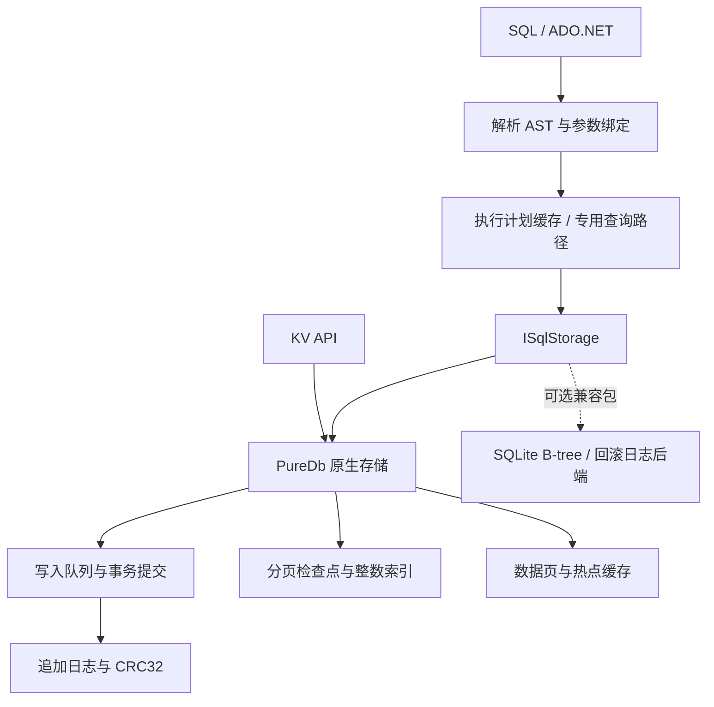

# PureDb — 纯 .NET 10 文件数据库

[](https://github.com/hnlyf168/PureDb/actions/workflows/ci.yml)
[](https://www.nuget.org/packages/PureDb)
[](LICENSE)

PureDb 使用 C# 和 .NET 10 标准库实现嵌入式数据库，提供 KV、SQL、JOIN、JSON、事务、多线程写入、多进程访问和 ADO.NET。核心与可选 SQLite 文件兼容库均无原生库和第三方 NuGet 依赖。

**主分支源码版本：`1.0.0-preview.2`；NuGet 已发布版本：`1.0.0-preview.1`。** 当前主分支包含 SQL 扩展及性能优化，`preview.2` 尚未发布至 NuGet。SQL、文件协议和事务能力有明确边界；当前没有在所有性能、CPU、内存指标上超过 SQLite。

[SQL 支持与不支持清单](docs/SQL-SUPPORT.md) · [安装与使用](docs/USAGE.md) · [ADO.NET](docs/ADO.NET.md) · [SQLite 文件兼容](docs/SQLITE-COMPATIBILITY.md) · [全面性能表](docs/PERFORMANCE.md) · [CPU / 内存谁更高](docs/RESOURCES.md) · [可筛选性能面板](docs/PERFORMANCE.html) · [原始结果](benchmarks/results/latest) · [自动发布](docs/RELEASING.md)

主分支已包含 **复合索引、外键、CHECK、UPSERT、视图、行触发器、CTE、窗口、相关子查询、集合运算、JSON5 / JSON 表函数、SQL 事务和保存点**，以及 C# 用户函数、查询快路径和中文注释。各项限制、示例和未支持语法集中见 [SQL 清单](docs/SQL-SUPPORT.md)。下面的功能矩阵对应 `main` 源码；全面性能表已使用本轮冻结的 `preview.2` 构建在 Windows 和 Linux ARM64 完整重测，另有 [排序专项报告](docs/SORT-PERFORMANCE.md) 和 [本轮优化前后对照](docs/OPTIMIZATION.md)。[开发验证](docs/DEVELOPMENT-VALIDATION.md) 与 [扩展进度](docs/FEATURE-WORK.md) 记录实际验证和剩余工作。

## 安装

安装已发布的 NuGet 版本：

```bash
dotnet add package PureDb --version 1.0.0-preview.1
# 需要原地读取/修改受支持的 SQLite 文件时额外安装：
dotnet add package PureDb.SqliteCompatibility --version 1.0.0-preview.1
```

使用 `preview.2` 的新增 API 和优化时，请从 `main` 构建源码；构建及本地打包命令见文末。两个包的版本统一由 [Directory.Build.props](Directory.Build.props) 定义，变更见 [CHANGELOG](CHANGELOG.md)。

```csharp
using PureDb;

await using var db = new SqlDatabase("app.pdb");
await db.ExecuteAsync("CREATE TABLE IF NOT EXISTS users(id INTEGER PRIMARY KEY,name TEXT NOT NULL,profile JSON)");
await db.ExecuteAsync("INSERT INTO users VALUES(@id,@name,@profile)",
    new Dictionary<string, object?>
    {
        ["id"] = 1L, ["name"] = "小明", ["profile"] = "{\"age\":25}"
    });
var result = db.Query("SELECT name,json_extract(profile,'$.age') AS age FROM users WHERE id=@id",
    new Dictionary<string, object?> { ["id"] = 1L });
Console.WriteLine(result.Rows[0][0]);
```

KV 使用 `Database`，SQL 使用 `SqlDatabase`，各自使用独立文件。SQL 表需要 `INTEGER PRIMARY KEY`，主键范围 `[0, 2^40)`。

主分支 `preview.2` 支持将 C# 方法注册为 SQL 标量函数，`SqlDatabase` 和 ADO.NET 连接都提供相同入口：

```csharp
db.CreateFunction<string?, bool>("RELIGIBLE", user => user is "Alice" or "小明");
var eligible = db.Query("SELECT * FROM users WHERE RELIGIBLE(name)");
```

函数按连接、名称和参数数量注册，可替换或移除。强类型入口直接调用委托，布尔结果复用 SQL 0/1 对象，省去逐行参数数组和布尔装箱；NULL、BLOB 复制和业务异常仍经过边界检查。上述 API 尚不在 NuGet 的 `preview.1` 中，使用方法及限制见 [用户函数](docs/USER-FUNCTIONS.md)。

## 与 SQLite 功能对比

基准：PureDb `1.0.0-preview.2` **主分支源码** / SQLite `3.54.1`。✅ 已实现，⚠️ 有限制或需额外组件，❌ 尚未实现。功能标记表示支持范围，不表示相同的实现、成熟度或性能。

| 功能 | PureDb | SQLite |
| :--- | :--- | :--- |
| 纯 .NET、无原生依赖 | ✅ 核心和兼容库均为托管 C# | ⚠️ 原版为 C 内核，.NET 通常通过原生绑定使用 |
| 嵌入式文件数据库 | ✅ 自有追加日志及索引侧文件 | ✅ SQLite 数据文件及可选日志侧文件 |
| KV / SQL API | ✅ 独立 KV 与 SQL API | ⚠️ 通过 SQL 表实现 KV |
| 参数化 SQL、增删改查 | ✅ 支持的 SQL 子集 | ✅ 更完整的 SQL 方言 |
| INNER / LEFT / RIGHT / FULL / CROSS JOIN | ✅ 哈希查找或通用循环执行 | ✅ 支持 |
| GROUP BY / HAVING / ORDER BY / LIMIT | ✅ 支持 | ✅ 支持 |
| 应用自定义 SQL 函数 | ⚠️ C# 标量函数、强类型和可变参数入口；自定义聚合、窗口和表值函数尚未实现 | ✅ 标量、聚合、窗口及表值扩展接口 |
| 普通、唯一、JSON 路径索引 | ✅ 单列及指定表达式 | ✅ 支持更多索引形态 |
| 复合索引 | ⚠️ 左前缀、范围、混合排序及唯一性；定义持久化，数据惰性内存构建 | ✅ 支持分页增量索引 |
| CHECK / UPSERT | ⚠️ 列级及表级 CHECK；单分支冲突插入或更新，详细边界见 SQL 清单 | ✅ 支持更完整冲突语法 |
| 外键、视图、触发器 | ⚠️ 外键五种动作及延迟校验、普通视图、行触发器；原版格式 | ✅ 支持更多模式及控制选项 |
| CTE、窗口函数、子查询、集合 | ⚠️ 普通/受控递归 CTE、排名/偏移/聚合窗口、相关子查询、UNION/INTERSECT/EXCEPT | ✅ 支持更完整语法和优化 |
| JSON 文本、路径查询与修改 | ✅ 已实现函数及路径子集 | ✅ JSON 函数及操作符 |
| JSONB | ⚠️ 自有 PJB1 格式，与 SQLite JSONB 不互通 | ✅ SQLite 自有 JSONB 格式 |
| JSON5 / json_each / json_tree | ⚠️ 已实现；深度 128，节点 ID 与 SQLite 不同 | ✅ 支持 |
| 批量新增、更新、删除 | ✅ 单事务多操作、区间 DML | ✅ 事务及 SQL 批处理 |
| 多线程写入 | ✅ 有界队列、单写入者、分组刷盘 | ✅ 多连接协调，写事务串行 |
| 多进程访问 | ✅ 原生格式 Shared 模式 | ✅ 文件锁；WAL 支持并发读取 |
| ADO.NET | ✅ 内置 Connection / Command / Reader / Transaction | ⚠️ 使用 Microsoft.Data.Sqlite 等额外提供程序 |
| 事务 | ⚠️ BEGIN / COMMIT / END / ROLLBACK；乐观 Serializable，Shared 只支持 DEFERRED | ✅ SQLite 事务及文件锁协议 |
| SAVEPOINT / ROLLBACK TO / RELEASE | ✅ SQL 与 ADO.NET 保存点、DDL 回滚 | ✅ 支持 |
| 完整 SQLite SQL / 类型 / 锁协议 | ❌ 支持子集，完整边界见 SQL 清单 | ✅ 原生实现 |
| 启动恢复、校验、压缩 | ✅ 检查点、CRC32、日志恢复、Compact | ✅ 日志恢复、integrity_check、VACUUM |
| 原地读写 SQLite 文件 | ⚠️ 可选纯 .NET 兼容包；UTF-8 / 4096 页 / 独占回滚日志子集 | ✅ 原生完整协议 |
| SQLite WAL 文件协议兼容 | ❌ 兼容包拒绝 WAL | ✅ 支持 |
| 跨平台验证 | ✅ Windows x64、Linux ARM64 | ✅ 多平台 |

SQLite 能力依据官方 [SQL 文档](https://www.sqlite.org/lang.html)、[自定义函数](https://www.sqlite.org/appfunc.html)、[JSON 文档](https://www.sqlite.org/json1.html)、[WAL 文档](https://www.sqlite.org/wal.html)；其 .NET 提供程序见 [Microsoft.Data.Sqlite](https://learn.microsoft.com/en-us/dotnet/standard/data/sqlite/)。PureDb 的逐类语法、例子、原理和限制见 [SQL 支持清单](docs/SQL-SUPPORT.md)。

## 主分支 preview.2 排序专项

<!-- SORT:START -->

10 万行热缓存排序，三轮中位数；数值越低越好。此表对应主分支 `preview.2` 源码，CPU 是每次查询消耗的时间。

| 平台 | 场景 | PureDb 耗时 µs | SQLite 耗时 µs | 耗时谁更低 | PureDb CPU µs | SQLite CPU µs | CPU 谁更低 |
| --- | --- | ---: | ---: | --- | ---: | ---: | --- |
| Windows x64 | 排序取 20 行 | 1,470.331 | 5,458.272 | 🟩 PureDb 3.71× | 1,467.710 | 5,434.783 | 🟩 PureDb 3.70× |
| Windows x64 | 降序取 20 行，跳过 100 行 | 1,584.021 | 5,909.214 | 🟩 PureDb 3.73× | 1,572.327 | 5,769.231 | 🟩 PureDb 3.67× |
| Windows x64 | 排序取 4096 行 | 5,827.236 | 12,769.402 | 🟩 PureDb 2.19× | 5,813.953 | 12,711.864 | 🟩 PureDb 2.19× |
| Windows x64 | 主键范围取 20 行（对照） | 2.719 | 7.093 | 🟩 PureDb 2.61× | 2.719 | 7.093 | 🟩 PureDb 2.61× |
| Linux ARM64 | 排序取 20 行 | 3,004.849 | 8,464.500 | 🟩 PureDb 2.82× | 3,010.952 | 8,496.708 | 🟩 PureDb 2.82× |
| Linux ARM64 | 降序取 20 行，跳过 100 行 | 3,743.834 | 9,062.982 | 🟩 PureDb 2.42× | 3,744.657 | 9,074.410 | 🟩 PureDb 2.42× |
| Linux ARM64 | 排序取 4096 行 | 15,285.600 | 20,145.197 | 🟩 PureDb 1.32× | 15,285.600 | 20,147.395 | 🟩 PureDb 1.32× |
| Linux ARM64 | 主键范围取 20 行（对照） | 6.311 | 10.051 | 🟩 PureDb 1.59× | 6.311 | 10.057 | 🟩 PureDb 1.59× |

托管分配相对优化前的变化、全部四个场景及方法见 [排序专项报告](docs/SORT-PERFORMANCE.md)。分配减少不等于 RSS 降低；此专项不代表全部 SQL 已超过 SQLite。

<!-- SORT:END -->

## 主分支 preview.2 与 SQLite 全面对比

**下方完整对比对应本轮 `preview.2` 开发构建，尚未发布至 NuGet。** Windows 与 Linux ARM64 使用同一份 DLL；旧的全面对比记录已替换。本轮优化的收益与仍落后项目见 [优化报告](docs/OPTIMIZATION.md)。

<!-- PERFORMANCE:START -->

主分支 `1.0.0-preview.2` 开发构建原生格式 vs SQLite 3.54.1，同机三轮中位数。该版本尚未发布至 NuGet。CPU 为满吞吐进程占用，内存为单库独立测量。使用率高不代表每次查询更费 CPU。以下是代表场景，全部 41 项、ADO、CPU 和文件数据见完整报告。

| 平台 | PureDb 耗时胜 | SQLite 耗时胜 | 接近 |
| --- | --- | --- | --- |
| Windows x64 | 33 | 6 | 2 |
| Linux ARM64 | 27 | 13 | 1 |

### Windows x64

| 项目 | PureDb | SQLite | 谁更低 |
| --- | --- | --- | --- |
| SQL 主键完整行（µs/queries） | 0.387 | 5.205 | 🟩 PureDb 13.44× |
| SQL 范围 20 行（µs/queries） | 2.903 | 14.665 | 🟩 PureDb 5.05× |
| INNER JOIN（µs/queries） | 1.241 | 10.242 | 🟩 PureDb 8.25× |
| JSON 表达式索引（µs/queries） | 2.553 | 21.555 | 🟩 PureDb 8.44× |
| JSON 整数取余计数（µs/queries） | 3.887 | 492.965 | 🟩 PureDb 126.81× |
| Full 逐条新增（µs/rows） | 24,428.963 | 24,174.499 | 🟨 接近 |
| Full 逐条更新（µs/rows） | 25,795.701 | 28,820.095 | 🟩 PureDb 1.12× |
| Full 逐条删除（µs/rows） | 26,060.507 | 23,710.411 | 🟥 SQLite 1.10× |
| Full 批量新增（µs/rows） | 30.731 | 36.436 | 🟩 PureDb 1.19× |
| Full 批量更新（µs/rows） | 28.249 | 53.217 | 🟩 PureDb 1.88× |
| Full 批量删除（µs/rows） | 25.974 | 52.419 | 🟩 PureDb 2.02× |
| Buffered 批量新增（µs/rows） | 2.209 | 1.744 | 🟥 SQLite 1.27× |
| Buffered 批量更新（µs/rows） | 1.663 | 18.352 | 🟩 PureDb 11.04× |
| Buffered 批量删除（µs/rows） | 1.464 | 15.869 | 🟩 PureDb 10.84× |
| 四进程读取（µs/queries） | 32.935 | 15.908 | 🟥 SQLite 2.07× |
| 四进程原子更新（µs/updates） | 205.403 | 110.762 | 🟥 SQLite 1.85× |
| 重开并首次范围查询（µs/opens） | 677.960 | 610.100 | 🟥 SQLite 1.11× |

| 内存场景 | PureDb RSS MiB | SQLite RSS MiB | 谁更高、高多少 |
| --- | --- | --- | --- |
| point | 86.36 | 78.93 | **PureDb 更高**：多 7.43 MiB，高 9.4% |
| range | 56.68 | 56.50 | **PureDb 更高**：多 0.18 MiB，高 0.3% |
| json | 61.38 | 45.45 | **PureDb 更高**：多 15.94 MiB，高 35.1% |

| 主键查询 CPU 指标 | PureDb | SQLite | 谁更高、高多少 |
| --- | --- | --- | --- |
| 占整机 CPU % | 8.333 | 8.507 | **SQLite 更高**：多 0.174 个百分点，高 2.1% |
| 每次查询 CPU µs | 0.387 | 5.313 | **SQLite 更高**：多 4.926 µs，高 1271.7% |

### Linux ARM64

| 项目 | PureDb | SQLite | 谁更低 |
| --- | --- | --- | --- |
| SQL 主键完整行（µs/queries） | 1.127 | 3.579 | 🟩 PureDb 3.18× |
| SQL 范围 20 行（µs/queries） | 6.564 | 19.315 | 🟩 PureDb 2.94× |
| INNER JOIN（µs/queries） | 6.064 | 12.247 | 🟩 PureDb 2.02× |
| JSON 表达式索引（µs/queries） | 5.711 | 30.097 | 🟩 PureDb 5.27× |
| JSON 整数取余计数（µs/queries） | 12.967 | 668.052 | 🟩 PureDb 51.52× |
| Full 逐条新增（µs/rows） | 2,113.026 | 1,035.954 | 🟥 SQLite 2.04× |
| Full 逐条更新（µs/rows） | 1,113.355 | 1,362.941 | 🟩 PureDb 1.22× |
| Full 逐条删除（µs/rows） | 1,368.571 | 1,484.841 | 🟩 PureDb 1.08× |
| Full 批量新增（µs/rows） | 41.431 | 17.647 | 🟥 SQLite 2.35× |
| Full 批量更新（µs/rows） | 32.696 | 13.798 | 🟥 SQLite 2.37× |
| Full 批量删除（µs/rows） | 11.885 | 9.678 | 🟥 SQLite 1.23× |
| Buffered 批量新增（µs/rows） | 9.179 | 7.372 | 🟥 SQLite 1.25× |
| Buffered 批量更新（µs/rows） | 9.507 | 14.225 | 🟩 PureDb 1.50× |
| Buffered 批量删除（µs/rows） | 10.673 | 6.917 | 🟥 SQLite 1.54× |
| 四进程读取（µs/queries） | 68.317 | 31.979 | 🟥 SQLite 2.14× |
| 四进程原子更新（µs/updates） | 297.658 | 60.261 | 🟥 SQLite 4.94× |
| 重开并首次范围查询（µs/opens） | 1,244.560 | 407.920 | 🟥 SQLite 3.05× |

| 内存场景 | PureDb RSS MiB | SQLite RSS MiB | 谁更高、高多少 |
| --- | --- | --- | --- |
| point | 100.54 | 77.62 | **PureDb 更高**：多 22.91 MiB，高 29.5% |
| range | 69.75 | 56.95 | **PureDb 更高**：多 12.79 MiB，高 22.5% |
| json | 74.88 | 51.09 | **PureDb 更高**：多 23.79 MiB，高 46.6% |

| 主键查询 CPU 指标 | PureDb | SQLite | 谁更高、高多少 |
| --- | --- | --- | --- |
| 占整机 CPU % | 15.675 | 12.541 | **PureDb 更高**：多 3.134 个百分点，高 25.0% |
| 每次查询 CPU µs | 1.413 | 3.585 | **SQLite 更高**：多 2.172 µs，高 153.6% |

<!-- PERFORMANCE:END -->

🟩 PureDb 更低，🟥 SQLite 更低，🟨 差距小于 5%。**耗时、CPU 时间、驻留内存分别评判。** KV 对 SQL、纯 SQL 对 SQL、ADO.NET 对 SQLite C API 的接口差异在报告中单独说明。热缓存与重复聚合的优势不能外推到所有业务。

## 原理、实现思路与技术

### 1. 分层：SQL 与存储引擎解耦



核心项目包含原生存储、SQL 和 ADO.NET。`PureDb.SqliteCompatibility` 单向依赖核心，实现同一存储抽象，核心不依赖兼容库。默认创建的是 PureDb 文件；只有显式使用兼容入口才处理 SQLite 文件。

### 2. 存储：追加日志、校验与分页检查点

提交将变更编码为事务帧，记录长度、长度反码、CRC32 和操作列表，顺序追加到日志。值留在磁盘，主键索引保存值的位置、长度及校验信息。追加设计减少原地随机修改，但会累积旧版本，需要压缩回收。

主索引由分页持久化检查点、内存增量与有界热点页组成。有效检查点存在时，打开只读元数据，再恢复检查点之后的日志尾部；检查点缺失或失效则扫描重建。数据库变大不要求每次都加载全部数据，但恢复尾部、重建和完整校验仍可能与数据量相关。整数 SQL 索引也以页为单位延迟读取。

默认按访问验证索引页和数据值的 CRC。覆盖索引只访问索引时，不会同时扫描未请求的数据负载；`VerifyOnOpen` / `VerifyIntegrity` 用于完整校验。校验和用于发现损坏，不等同于纠错。

源码：[原生引擎](src/PureDb/Database.cs)、[主索引与检查点](src/PureDb/Database.Checkpoint.cs)、[分页索引](src/PureDb/DiskIndex.cs)。

### 3. 写入：有界队列、批量事务与分组提交

Full 写入通过 `Channel` 有界队列进入单写入者，合并一组请求的日志写入与刷盘，分别保留事务边界，并在确认前完成刷盘。一个批次包含多条变更时，共享编码、提交和同步成本。Buffered SQL 可以在调用线程提交，减少队列往返，但它和 SQLite WAL/NORMAL 的 checkpoint、关闭及断电行为不同。

`ReaderWriterLockSlim` 协调实例内访问；Shared 模式使用命名 Mutex、协调戳内存映射及日志追赶处理多进程更新。协调戳是缓存提示，日志与代际校验才是恢复依据。写入仍然串行，更多线程不保证线性加速。

源码：[写入与恢复](src/PureDb/Database.cs)、[SQL 事务](src/PureDb/Sql/SqlTransactionSession.cs)。

### 4. 查询：识别常见形状，减少通用执行开销

SQL 先解析成 AST，再缓存参数绑定、列投影和受支持的执行计划。主键查询直接定位记录；只投影主键时可使用覆盖索引。整数范围查询以精确二分为基础，增加经过实际键验证的估算探测；偏斜或不适合的分布保留精确查找。小 LIMIT 验证最后候选键后，减少另一端边界搜索和读页。

区间 UPDATE / DELETE 直接读取目标范围，避免先解码整表；没有 UNIQUE 约束时省去约束集合。通用谓词和不支持的优化形状走通用执行器，不能把专用路径的倍率当作所有 SQL 的速度。

主分支 `preview.2` 新增小分页排序：输入未满足 `ORDER BY`、无分组及 DISTINCT、`OFFSET + LIMIT <= 4096` 时，用 `PriorityQueue` 保留最好的 K 行，堆顶始终是最差候选。纯列查询只保留输入行引用，入选后再生成结果投影；含表达式时，淘汰候选的投影与键数组作为下一行缓冲区复用。排序候选的保留空间从随 N 行增长降到随 K 行增长；比较工作为 O(N log K)，已命中索引顺序的查询继续直接分页。

比较器复用 SQL 的 NULL、整数/实数、文本和 BLOB 规则，整数对整数先直接比较，省去 JSON 解包和存储类别判断，并以原始输入序号保持相同键的稳定顺序。含表达式的查询仍逐行执行投影，`ORDER BY` 别名复用投影值，易变 C# 函数每行调用次数及未入选行异常保持一致。大分页、分组、去重回退到原执行器；表缓存、函数结果和最终输出仍有额外内存，O(K) 只描述排序候选缓冲区。

源码：[查询分派](src/PureDb/Sql/SqlQuery.cs)、[有界排序](src/PureDb/Sql/SqlQuery.TopSort.cs)、[范围查询](src/PureDb/Sql/SqlDiskRange.cs)、[区间 DML](src/PureDb/Sql/SqlDmlPlan.cs)。

### 5. JOIN、聚合、JSON 与 SIMD

等值 JOIN 可使用缓存哈希查找及直接投影，其他形状保留通用循环。无过滤 COUNT 使用维护的精确计数；分组计数可复用按数据版本生成的统计与排序结果。写入后会失效或重建，缓存有内存和首次建立成本。

JSON 路径及解析结果可复用；整数派生列采用连续数组，对受支持的“正的 2 次幂取余等于零”计数使用 `System.Numerics.Vector<long>` 位运算，保留 NULL 和负数语义。其他条件走标量或通用路径。CRC32 同样有硬件/向量路径与回退。硬件通道数不等于实测加速倍率。

PureDb 在部分用例比 SQLite 快，主要来自这些专用路径、版本化缓存和减少物化工作；SQLite 也使用索引和字节码执行。本项目同时保存参测 SQLite 的 EXPLAIN 计划，避免把优势误解成“SQLite 没有索引”。

源码：[JOIN](src/PureDb/Sql/SqlJoinPlan.cs)、[聚合](src/PureDb/Sql/SqlAggregate.cs)、[SIMD 计数](src/PureDb/Sql/SqlDerivedCount.cs)、[JSON](src/PureDb/Sql/SqlJson.cs)、[CRC](src/PureDb/Crc32.Vectorized.cs)。

### 6. 内存、ADO.NET 和兼容模式的边界

数据页缓存默认 64 MiB，SQL 行缓存另有 64 MiB 估算预算，索引、执行计划、结果和运行时还有额外占用，不能把缓存预算当成进程内存上限。BLOB 返回独立副本；数据和模式版本决定缓存何时失效。当前内存占用仍有弱于 SQLite 的场景。

ADO.NET 提供 Connection、Command、Parameter、DataReader、DbTransaction 和 ProviderFactory。事务使用带冲突检测的乐观 Serializable；调用方需要处理冲突重试。ADO.NET 兼容不等于已兼容所有 ORM 及完整 SQLite SQL。

兼容包实现 SQLite B-tree 页、record 编码、overflow 和回滚日志子集；仅允许声明的格式及独占使用方式。默认写入可能重建整库，实验增量更新只覆盖特定页内修改，其他情况回退。WAL、未知模式和未实现协议明确拒绝。详细限制见 [兼容文档](docs/SQLITE-COMPATIBILITY.md)。

## 构建、验证与复现

需要 .NET SDK `10.0.402`。核心无第三方包，`NuGet.Config` 可离线恢复。SQLite 原生库仅用于测试和对比，不进入发布包。

```bash
dotnet build PureDb.slnx -c Release
dotnet pack src/PureDb -c Release --no-build -o artifacts/packages
dotnet pack src/PureDb.SqliteCompatibility -c Release --no-build -o artifacts/packages
python scripts/prepare-sqlite.py
python scripts/test.py
# 小分页排序专项，与 SQLite 核对结果后测量耗时、CPU 时间和托管分配：
dotnet run -c Release --no-build --project tests/PureDb.SortTests -- --measure
# 创建 10 万行数据集，然后以程序输出的目录运行：
dotnet run -c Release --no-build --project benchmarks/PureDb.QueryBenchmarks -- 100000 1
python scripts/run-benchmarks.py artifacts/new-comparison DATASET --tests --memory --ado
```

CI 在 Windows / Linux 上构建并运行回归和 SQLite 差分查询，检查中文源码文档、格式及实际 NuGet 包。性能测量按主机串行进行；仓库分别保留 [完整预览版对比](benchmarks/results/latest)、[用户函数专项](benchmarks/results/functions/latest) 和 [本次排序优化前后](benchmarks/results/sort/latest) 的最新证据，不保存测试数据库或运行库二进制。复现细节见 [基准方法](docs/BENCHMARKS.md)。

## 自动发布与许可

`main` 当前版本为 `1.0.0-preview.2`。合并或推送主分支会运行 CI；发布对应的 `v1.0.0-preview.2` 标签后，[发布流水线](.github/workflows/publish.yml) 才会校验版本、执行 Windows / Linux 测试、打包两个纯 .NET 包、发布至 NuGet 并创建 GitHub 预发布。仓库需要配置 Actions Secret `NUGET_API_KEY`；失败的任务会停止后续发布。NuGet 的两个包独立接收上传，跨包发布不具有原子性。详见 [发布说明](docs/RELEASING.md)。

项目采用 [MIT](LICENSE)。CRC 向量实现的来源和版权声明见 [第三方声明](THIRD-PARTY-NOTICES.md)。
