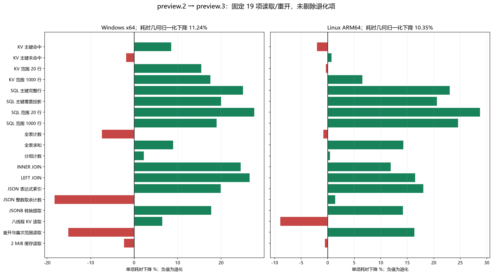

# 用纯 .NET 10 写一个文件数据库：PureDb 1.0.0-preview.3 的查询优化、SQLite 兼容与实测

PureDb 是一个 MIT 开源的嵌入式文件数据库：核心和可选 SQLite 兼容包都使用 C# / .NET 10 标准库，不依赖原生 SQLite 运行库。本文记录本次真实优化和测试，也公开仍落后及尚不兼容的部分。

[GitHub 源码](https://github.com/hnlyf168/PureDb) · [NuGet 主库](https://www.nuget.org/packages/PureDb/1.0.0-preview.3) · [可选兼容包](https://www.nuget.org/packages/PureDb.SqliteCompatibility/1.0.0-preview.3)

## 先看结果：原版格式查询变快了多少

| 平台 | 吞吐倍率 | 吞吐提升 | 归一化耗时下降 | 至少下降 10% |
| --- | --- | --- | --- | --- |
| Windows x64 | 1.127× | 12.66% | 11.24% | ✅ |
| Linux ARM64 | 1.115× | 11.55% | 10.35% | ✅ |

以上采用预先保留的固定 19 项读取/重开集合，计算各项三轮中位数比值的几何平均，包含退化项。不是每一项提升 10%，也不是全部增删改提升 10%。旧版是已发布 preview.2，使用同一个新测试宿主，仅替换内核 DLL。



## 与 SQLite 全面对照：所有 41 项都保留

数值是 SQLite 耗时 ÷ PureDb 耗时；大于 1 表示 PureDb 更快，小于 1 表示 SQLite 更快。绿色是 PureDb 领先，红色是 SQLite 领先，灰色为差距小于 5%。这些是原版格式的成绩。


### Windows x64

41 项耗时：PureDb 领先 **32**、SQLite 领先 **8**、接近 **1**。胜负计数不是业务加权总分。

| 场景 | PureDb µs/单位 | SQLite µs/单位 | 谁更快 |
| --- | --- | --- | --- |
| sql_point | 0.323 | 5.304 | 🟩 PureDb 16.44× |
| sql_range20 | 2.305 | 14.827 | 🟩 PureDb 6.43× |
| sql_join | 0.951 | 10.562 | 🟩 PureDb 11.11× |
| json_scan | 4.784 | 515.405 | 🟩 PureDb 107.74× |
| Full_single | 26,346.146 | 31,760.512 | 🟩 PureDb 1.21× |
| Full_batch1000 | 42.384 | 57.303 | 🟩 PureDb 1.35× |
| Full_batch_update | 38.616 | 54.922 | 🟩 PureDb 1.42× |
| Full_batch_delete | 36.581 | 59.050 | 🟩 PureDb 1.61× |
| shared_update | 228.206 | 179.760 | 🟥 SQLite 1.27× |
| reopen_and_first_range | 721.320 | 637.020 | 🟥 SQLite 1.13× |

### Linux ARM64

41 项耗时：PureDb 领先 **26**、SQLite 领先 **14**、接近 **1**。胜负计数不是业务加权总分。

| 场景 | PureDb µs/单位 | SQLite µs/单位 | 谁更快 |
| --- | --- | --- | --- |
| sql_point | 0.887 | 3.537 | 🟩 PureDb 3.99× |
| sql_range20 | 5.186 | 20.521 | 🟩 PureDb 3.96× |
| sql_join | 5.431 | 12.535 | 🟩 PureDb 2.31× |
| json_scan | 13.442 | 684.088 | 🟩 PureDb 50.89× |
| Full_single | 1,011.368 | 871.288 | 🟥 SQLite 1.16× |
| Full_batch1000 | 17.696 | 9.516 | 🟥 SQLite 1.86× |
| Full_batch_update | 19.960 | 16.874 | 🟥 SQLite 1.18× |
| Full_batch_delete | 10.210 | 7.404 | 🟥 SQLite 1.38× |
| shared_update | 265.254 | 59.532 | 🟥 SQLite 4.46× |
| reopen_and_first_range | 647.320 | 506.560 | 🟥 SQLite 1.28× |

查询单位为每次查询，逐条与批量写入为每行，重开为每次 open。完整 41 项、ADO.NET、CPU 和文件数据见 [全面报告](PERFORMANCE.md)。

## CPU、内存和落盘：谁高，高多少


CPU 使用率是满吞吐时占整机的比例；完成的请求数不同，不能只用这个百分比判断效率。CPU µs/次才是完成相同工作量的 CPU 成本。RSS 是独立进程、单个 SQL 库访问后 GC 的驻留内存，包含托管与原生；SQLite 原生内存不能用 .NET 分配计数代替。

### Windows x64 资源

| 场景 | PureDb RSS MiB | SQLite RSS MiB | 谁占更多 |
| --- | --- | --- | --- |
| point | 87.00 | 78.85 | PureDb 更高 8.15 MiB（10.3%） |
| range | 56.28 | 56.56 | SQLite 更高 0.28 MiB（0.5%） |
| json | 61.60 | 45.41 | PureDb 更高 16.19 MiB（35.6%） |

主键完整行每次 CPU：PureDb **0.323 µs**，SQLite **5.304 µs**；SQLite 多消耗 4.981 µs（1543.5%）。

### Linux ARM64 资源

| 场景 | PureDb RSS MiB | SQLite RSS MiB | 谁占更多 |
| --- | --- | --- | --- |
| point | 101.80 | 77.64 | PureDb 更高 24.15 MiB（31.1%） |
| range | 74.25 | 56.73 | PureDb 更高 17.52 MiB（30.9%） |
| json | 75.75 | 49.68 | PureDb 更高 26.08 MiB（52.5%） |

主键完整行每次 CPU：PureDb **0.989 µs**，SQLite **3.546 µs**；SQLite 多消耗 2.557 µs（258.4%）。

文件体积含索引和日志侧文件；进程逻辑写入量、设备物理写入量和磁盘忙碌率是不同指标。[资源直观表](RESOURCES.md) 列明 CPU 差额和 RSS 差额，[完整报告](PERFORMANCE.md) 列明各场景文件体积及全机磁盘观察。Linux 内核缺失进程 I/O 计数时记录 -1，不能当作零；全机设备计数也不能全部归因于数据库。

## 这次具体优化了什么

第一，计划缓存从递归 record 哈希改成缓存 AST 的对象身份，加上表、模式等上下文。重复 SQL 命中缓存时少遍历一次语法树，仍在模式或用户函数变化时失效。第二，0–1023 的 long 装箱共享不可变对象，全列投影直接顺序解码，避免逐列定位与回填；BLOB 仍按所有权要求复制。

第三，JSON 派生计数弱缓存规范化表达式，减少每次生成表达式树；它不缓存参数值或最终计数，数据列仍按版本失效，现有 SIMD 路径继续实际计算。第四，检查点复用已排序的基础索引，归并新增部分，避免重新排序全部主键；计数更新减少一次字典定位。

第五，密集 KV 主键的热点页使用有界数组目录，减少字典散列；目录按已存记录数和预算分配，稀疏高位键不扩张数组。第六，相同编码的查询不反复写线程状态，跨 UTF-16 文件与原版 UTF-8 的嵌套用户函数调用仍保存并恢复编码。

原版内核采用追加日志、有界写队列、单写入者分组刷盘、主键与数值范围持久索引。批量写入把多行放进同一个原子帧。查询采用缓存绑定和专用计划，复合索引等结构按版本惰性建立。开库恢复从可信检查点与日志尾部追赶，保留 CRC 和边界检查。

已有 ARM CRC32 和特定 JSON 整数计数 SIMD 并非本轮新增，不能算成这次的 SIMD 收益。分支较多的 B-tree、锁和 SQL 绑定不能仅靠向量化解决。

## 为什么某些查询能比 SQLite 快很多

热查询可复用 PureDb 的已解码行、索引和派生列；主键覆盖投影不读取不需要的 BLOB，COUNT 可以使用维护的计数。SQLite C API 对照要经过原生语句执行及逐行逐列跨边界读取。两边都物化结果，但执行路径和可缓存结构不同，测得的是 .NET 应用调用成本。

PureDb 同时限制主键、类型亲和性和 SQL 子集，SQLite 支持的通用语义更多。追加格式与 B-tree/WAL 的维护和关闭成本也不同。因此，热缓存里几十倍的个别结果不能推导出所有工作负载、冷启动和大库都更快。首次构建缓存、关闭维护、超内存及兼容后端尤其需要另外测量。

## 功能对照

| 能力 | PureDb preview.3 | SQLite 3.54.1 |
| --- | --- | --- |
| 纯 .NET | ✅ 核心与兼容库纯托管 | 原生 C 内核，.NET 常用原生绑定 |
| ADO.NET / Native AOT | ✅ 内置 Provider；真实 AOT 验证 | 通过所选 .NET Provider |
| 复合索引 | ⚠️ 定义持久化、按版本内存构建 | ✅ 分页增量 B-tree |
| 外键 / CHECK / 视图 / 触发器 | ⚠️ 已支持公开子集并接入兼容文件 | ✅ 更完整控制与模式 |
| CTE / 窗口 / 子查询 / UNION | ⚠️ 已支持，仍有语法和优化边界 | ✅ 更成熟完整 |
| JSON5 / json_each / json_tree | ⚠️ 支持；JSONB 为自有格式，节点 ID 有差异 | ✅ 原生支持 |
| C# 用户函数 | ✅ 标量注册；聚合/窗口回调未支持 | 原生扩展，经绑定提供 .NET 入口 |
| SAVEPOINT / SQL 事务 | ⚠️ 保存点和乐观事务；锁语义有差异 | ✅ 原生文件事务与锁协议 |
| SQLite 文件原地读写 | ⚠️ 可选包，受限回滚日志与独占 | ✅ 原生完整协议 |
| WAL / 任意 SQLite 文件 | ❌ 尚未覆盖 | ✅ 原生支持 |

## 兼容性目标如何验收

| 平台 | 范围 | 通过 | 总数 | 通过率 |
| --- | --- | --- | --- | --- |
| Windows x64 | SQL 固定公共语料 | 175 | 175 | 100.00% |
| Windows x64 | 文件正向 profile / 故障注入 | 64 | 64 | 100.00% |
| Linux ARM64 | SQL 固定公共语料 | 175 | 175 | 100.00% |
| Linux ARM64 | 文件正向 profile / 故障注入 | 64 | 64 | 100.00% |

SQL 比较固定 175 条公开语料；文件比较 64 组正向 profile 和故障注入。它们分别超过 95% 的用例通过门槛，但**不能写成整体 SQLite 兼容性 95%**。WAL、类型亲和性、AUTOINCREMENT、FTS 等缺项并没有消失。[兼容性报告](COMPATIBILITY-REPORT.md) 公开分母、家族、语料哈希、源码及缺口。

兼容包新增 512–65536 的八种页大小、UTF-8/UTF-16LE/UTF-16BE，以及复合索引、外键、默认值、CHECK、视图和行触发器。修复编码影响的 BINARY 排序；BLOB 默认值和整数形 REAL 常量重开后保持其存储类别，避免 CHECK/TYPEOF 语义变化。

兼容写入保持原地文件句柄及回滚提交顺序。完整镜像路径也仅备份实际覆盖和截断的旧页，减少日志写放大；镜像计算仍随库大小增长，不能承诺大库点写很快。实验增量模式只在已实现的页更新条件成立时生效，其他情况回退。[兼容模式专项](SQLITE-FILE-PERFORMANCE.md) 单独比较，避免拿原版成绩替兼容模式背书。

## Native AOT 的体积、启动与性能

本轮重新发布两个独立宿主，实测 AOT、自包含 JIT 及 SQLite，运行文件体积包含可达运行时；SQLite 体积含其原生库。体积取决于应用可达代码，不是通用的“数据库库大小”。完整清单、CPU/RSS、热查询、写入及新进程启动见 [AOT 报告](AOT-PERFORMANCE.md)。

## 如何使用与复现

```bash
dotnet add package PureDb --version 1.0.0-preview.3
# 需要受限的 SQLite 文件原地读写才安装：
dotnet add package PureDb.SqliteCompatibility --version 1.0.0-preview.3
```

```csharp
using PureDb;
await using var db = new SqlDatabase("app.pdb");
await db.ExecuteAsync("CREATE TABLE users(id INTEGER PRIMARY KEY,name TEXT)");
await db.ExecuteAsync("INSERT INTO users VALUES(1,'Alice')");
db.CreateFunction<string?,bool>("RELIGIBLE", user => user == "Alice");
var eligible = db.Query("SELECT * FROM users WHERE RELIGIBLE(name)");
```

性能使用 Windows x64 与指定 Linux ARM64 同机串行三轮；.NET SDK 10.0.402 / runtime 10.0.13，SQLite 3.54.1，10 万行热查询，预热 500ms、测量至少 750ms。Full 是各自强制刷盘路径；Buffered 与 SQLite WAL/NORMAL 的检查点和断电语义不同。写入计时不含关闭，不能忽略 PureDb 关闭时可能完成的索引维护。ARM 绑定大核 4–7，两边一致。

复现入口：`scripts/run-release-pair.py`、`scripts/run-file-pair.py`、`scripts/publish-deployment.py`、`scripts/run-deployment.py`。所有公开样本、程序集 SHA256、时间和环境保存在 benchmarks/results；[方法与局限](BENCHMARKS.md) 说明缓存、接口及持久化口径。源码采用中文 XML 注释与格式检查。

当前适合接受明确 SQL 子集、需要纯 .NET 和可控部署的应用验证。需要完整 SQLite 方言、任意现有文件或成熟 WAL 并发时，应继续选 SQLite；纯托管兼容模式仍在推进。

## 博客园排版说明

本文是独立 Markdown 草稿，未代发博客。图片在同目录 `images/preview.3/`，同时提供 PNG 和 SVG；上传博客园时将 PNG 上传到图床，再替换相对图片路径。图由公开 JSON 绘制，非示意数据。
