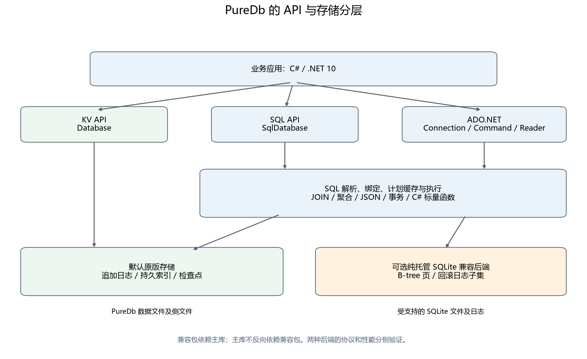
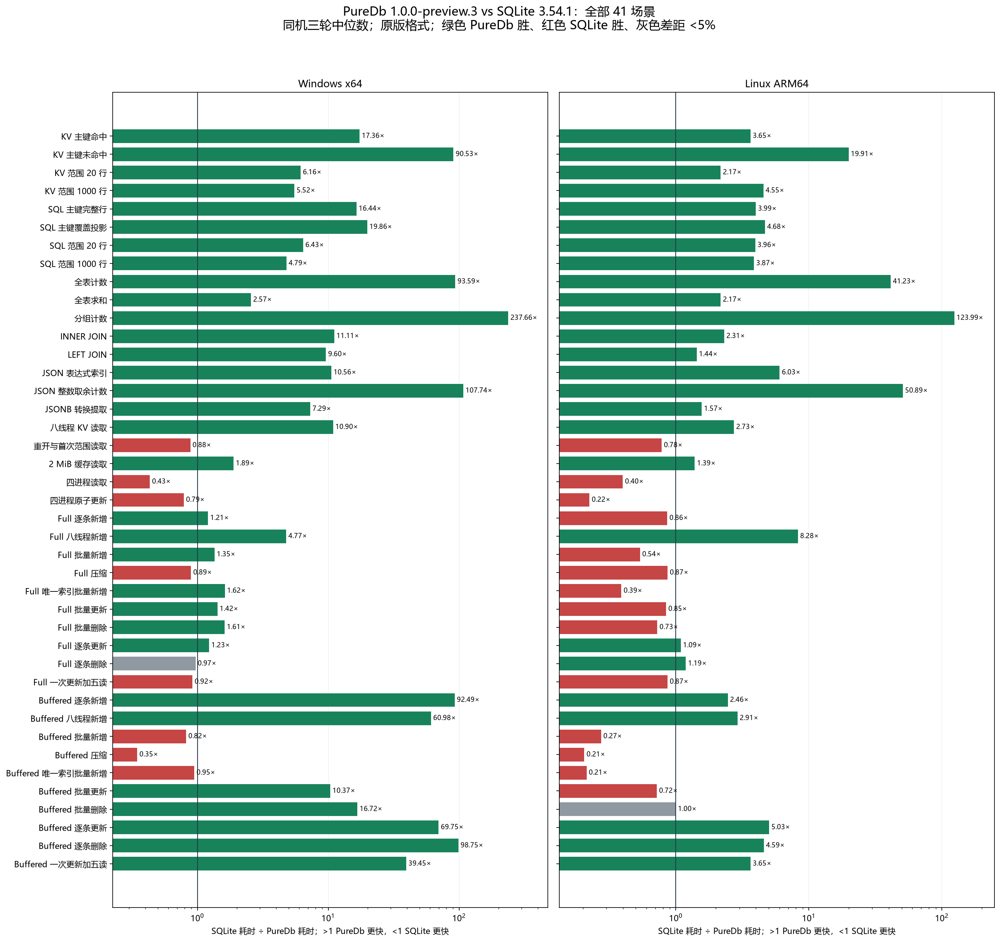
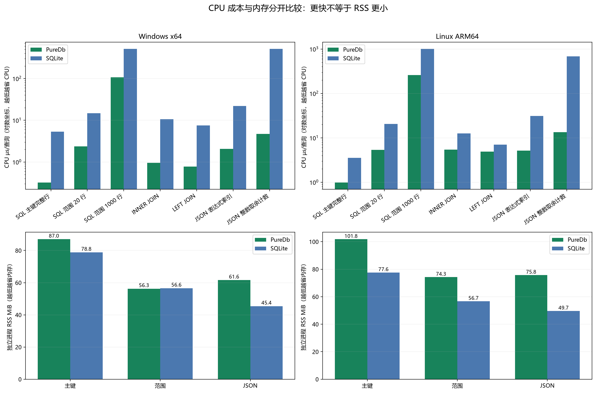

# PureDb 开源：用纯 .NET 10 实现一个支持 SQL、JSON 和 ADO.NET 的文件数据库

在 .NET 应用里保存本地数据，可以从一个 JSON 文件开始：读取、修改，再写回。需求继续增加后，就会遇到索引查询、批量更新、并发写入、事务回滚和故障恢复。文件仍然很适合交付，但管理这些文件的代码，已经逐渐变成一个小型数据库。

PureDb 就是围绕这类需求做的一个开源项目：用 C# 和 .NET 10 标准库实现嵌入式文件数据库，提供 KV、SQL、JOIN、JSON、事务、多线程写入、多进程访问和 ADO.NET。数据库跟随应用运行，不需要部署独立服务。主库以及可选的 SQLite 文件兼容库都是纯托管实现，没有原生 SQLite 运行库依赖。

这是对项目的一次完整介绍。本文使用已发布的 **1.0.0-preview.3 预览版**，从设计初衷和使用方式开始，再介绍存储与查询实现，最后给出与 SQLite 的功能、性能、CPU、内存和部署体积对照。项目仍在开发中，支持范围和实测落后项会一起列出。

[GitHub 源码](https://github.com/hnlyf168/PureDb) · [NuGet 主库](https://www.nuget.org/packages/PureDb/1.0.0-preview.3) · [可选兼容包](https://www.nuget.org/packages/PureDb.SqliteCompatibility/1.0.0-preview.3) · [预览版下载](https://github.com/hnlyf168/PureDb/releases/tag/v1.0.0-preview.3)

## 一、为什么做 PureDb

做这个项目的出发点，是希望在 .NET 技术栈中拥有一个可以直接理解、调试和扩展的本地存储内核。从文件编码、索引查找，到 SQL 执行、事务与恢复，都能在 C# 代码里追踪完整路径。

设计时主要考虑了四件事。

**首先是纯 .NET 部署。** 应用引用主库就能使用原版文件格式；需要读写受支持的 SQLite 文件时，再引用可选兼容包。两条路径都使用托管代码，减少分发不同平台原生运行库时需要处理的部署变量。纯托管仍然需要 .NET 运行时，或通过 Native AOT 把可达运行时代码编入应用，并不代表运行时和文件体积没有成本。

**其次是同时提供底层存储和 SQL。** 对明确的主键、整数范围和二进制内容，可以使用 KV API；需要表、连接、JSON 筛选和事务时，可以使用 SQL。同一个项目提供这两层能力，业务可以按实际查询需求选择入口。

**第三是把写入和查询作为完整链路设计。** 单条写入要考虑刷盘成本，多线程写入要控制排队和竞争，批量操作要摊薄事务开销；查询则需要同时考虑索引、解码、投影和结果物化。优化的是业务拿到结果或收到提交确认的过程。

**第四是与 .NET 应用自然衔接。** 除直接 SQL API 外，提供 ADO.NET 接口；业务规则可以通过 C# 标量函数注入 SQL。Native AOT、中文代码注释和可复现的差分测试，也是项目的一部分。

SQLite 是本地存储的重要参照。它已经覆盖了很广的文件协议和 SQL 语义，官方也将应用本地存储与需要独立服务的数据库场景作了区分。PureDb 的设计重点是纯 .NET 内核及其支持范围内的执行效率，选择时仍需一起考虑功能、可靠性、部署和维护成本。[SQLite 的适用场景说明](https://www.sqlite.org/whentouse.html)

## 二、先认识两种存储模式

PureDb 有两种文件模式，安装包和性能也需要分别理解。

| 选择 | 安装包与入口 | 实际保存的格式 | 使用边界 |
| --- | --- | --- | --- |
| 原版模式 | `PureDb`；`Database` / `SqlDatabase` | PureDb 自有追加日志及索引侧文件 | 默认内核；本文主要性能成绩来自此模式 |
| SQLite 文件模式 | 额外安装 `PureDb.SqliteCompatibility` | 受支持的 SQLite B-tree 文件与回滚日志 | 独占使用、格式及 SQL 子集有明确限制 |

兼容包依赖主库，主库不反向依赖兼容包。`new SqlDatabase("app.pdb")` 始终创建或打开 PureDb 原版格式；文件后缀本身不会把它切换为 SQLite 格式。原版文件可能有索引和协调侧文件，备份与迁移也需要考虑这些文件及连接状态。

两种模式共用 SQL 执行能力，但下面的存储协议不同：支持一条 SQL，不代表已经实现与它相关的所有 SQLite 文件协议。



## 三、从一个 .NET 控制台程序开始

新建 .NET 10 项目并安装主库：

```bash
dotnet new console -n PureDbDemo -f net10.0
cd PureDbDemo
dotnet add package PureDb --version 1.0.0-preview.3
```

下面的例子创建用户和订单表，写入一条带 JSON 的用户记录，再读取它。参数值单独绑定，表名和列名仍写在 SQL 中。

```csharp
using PureDb;

await using var db = new SqlDatabase("demo.pdb", new SqlDatabaseOptions
{
    Storage = new DatabaseOptions
    {
        Access = DatabaseAccess.Shared,
        Durability = Durability.Full
    }
});

await db.ExecuteAsync("""
    CREATE TABLE IF NOT EXISTS users(
        id INTEGER PRIMARY KEY,
        name TEXT NOT NULL,
        profile JSON
    );
    CREATE TABLE IF NOT EXISTS orders(
        id INTEGER PRIMARY KEY,
        user_id INTEGER REFERENCES users(id),
        quantity INTEGER NOT NULL
    );
    CREATE INDEX IF NOT EXISTS orders_user ON orders(user_id);
    CREATE INDEX IF NOT EXISTS users_age
        ON users(json_extract(profile,'$.age'));
    """);

await db.ExecuteAsync("""
    INSERT INTO users(id,name,profile) VALUES(@id,@name,@profile)
    ON CONFLICT(id) DO UPDATE SET
        name=excluded.name, profile=excluded.profile
    """, new Dictionary<string, object?>
    {
        ["id"] = 1L,
        ["name"] = "Alice",
        ["profile"] = "{\"age\":25,\"city\":\"杭州\"}"
    });

var result = db.Query("""
    SELECT id,name,json_extract(profile,'$.city') AS city
    FROM users
    WHERE json_extract(profile,'$.age') >= @minimumAge
    ORDER BY id LIMIT 20
    """, new Dictionary<string, object?> { ["minimumAge"] = 18L });

foreach (var row in result.Rows)
    Console.WriteLine($"{row[0]} / {row[1]} / {row[2]}");

Console.WriteLine(result.Plan);
```

`Query` 返回已物化的行、列名和执行计划信息。SQL 表必须有单列 `INTEGER PRIMARY KEY`，主键范围为 `[0, 2^40)`；普通列支持 `INTEGER`、`REAL`、`TEXT`、`BLOB`、`JSON`、`JSONB`，采用严格类型规则。这里显式使用 `Shared`，让多个连接或进程可以按原版协议协调访问；直接 SQL/KV 存储的默认访问方式是 `Exclusive`。

增删改同样使用 SQL。例如，更新 JSON 字段与删除指定记录：

```sql
UPDATE users
SET profile=json_set(profile,'$.age',26)
WHERE id=1;

DELETE FROM orders WHERE id=@orderId;
```

### 批量写入与事务

需要一起提交多行时，可以把命令放进同一个事务。以下代码接续上面的 `db`，重复执行时忽略已有主键：

```csharp
var commands = Enumerable.Range(100, 1000)
    .Select(id => new SqlCommand(
        """
        INSERT INTO users(id,name) VALUES(@id,@name)
        ON CONFLICT(id) DO NOTHING
        """,
        new Dictionary<string, object?>
        {
            ["id"] = (long)id,
            ["name"] = "用户" + id
        }))
    .ToArray();

await db.ExecuteTransactionAsync(commands);
```

SQL 入口还支持 `BEGIN`、`COMMIT`、`ROLLBACK` 和嵌套 `SAVEPOINT`。显式事务采用带版本冲突检测的乐观 Serializable；Shared 下只接受 `BEGIN DEFERRED`。调用方需要处理冲突并重做整个事务，这与 SQLite 的完整事务锁语义有区别。

对于底层记录，也可以直接使用 KV API。它的文件要与 SQL 库分开：

```csharp
using PureDb;
using System.Text;

await using var store = new Database("kv-demo.pdb");
await store.PutAsync(1, 20, Encoding.UTF8.GetBytes("hello"));
var record = store.Get(1);
var range = store.Query(10, 30, limit: 100);
Console.WriteLine(record is null ? "未找到" : Encoding.UTF8.GetString(record.Value));
```

这里的 `Id` 用于主键定位，`IndexKey` 用于整数范围查询，`Value` 保存二进制内容；应用自行决定内容如何编码。

## 四、SQL、JSON 和 C# 业务函数

目前的查询能力包括常见增删改查、INNER / LEFT / RIGHT / FULL / CROSS JOIN、分组聚合、复合索引、CTE、窗口函数、相关子查询和集合运算。外键、CHECK、视图、行触发器及 UPSERT 也已实现相应子集。

例如，在上述表结构中，可以用 CTE 和窗口函数为每个用户的订单排序，再通过 JOIN 读取数量最大的订单：

```sql
WITH ranked AS (
    SELECT id,user_id,quantity,
           ROW_NUMBER() OVER(
               PARTITION BY user_id ORDER BY quantity DESC,id
           ) AS position
    FROM orders
)
SELECT u.id,u.name,r.quantity
FROM users u
LEFT JOIN ranked r ON r.user_id=u.id AND r.position=1
ORDER BY u.id LIMIT 20;
```

JSON 支持路径读取、修改、表达式索引、JSON5 输入，以及 `json_each` / `json_tree` 表函数。普通 JSON 文本可以作为跨引擎交换形式；PureDb 的 JSONB 使用自有 PJB1 编码，与 SQLite JSONB 的二进制格式不互通。`json_tree` 的节点 ID 也不能作为与 SQLite 相同的稳定编号使用。SQLite 自身的 JSON 与 JSONB 能力见其[官方 JSON 文档](https://www.sqlite.org/json1.html)。

### 把 C# 方法注入 SQL

业务规则有时已经存在于 C# 中。可以注册一个标量函数，然后在 SQL 的筛选或投影中调用它：

```csharp
static bool IsEligible(string? user) => user is "Alice" or "张三";

db.CreateFunction<string?, bool>("RELIGIBLE", IsEligible);
var eligible = db.Query("SELECT * FROM users WHERE RELIGIBLE(name)");
```

这里的 `RELIGIBLE` 对应已注册的 C# 方法，SQL 列值作为参数传入；布尔结果可以用于 WHERE。函数按连接、名称和参数数量注册，支持替换及移除。函数实现不会保存进文件，连接重开后需要重新注入；含共享状态的业务委托也需要自行保证线程安全。

当前自定义入口支持标量函数，自定义聚合、窗口和表值回调尚未实现。SQLite 也提供应用自定义函数机制，PureDb 的区别在于直接提供托管委托注册入口及自己的执行器，不能据此认为 SQLite 缺少扩展能力。[SQLite 自定义函数文档](https://www.sqlite.org/appfunc.html)

### 使用 ADO.NET

已有代码使用 ADO.NET 抽象时，可以使用内置的 Connection、Command、Parameter、DataReader、Transaction 和 ProviderFactory。下面的代码接续同一个示例数据库：

```csharp
using PureDb.AdoNet;

await using var connection = new PureDbConnection(
    "Data Source=demo.pdb;Access=Shared;Durability=Full");
await connection.OpenAsync();

using var command = connection.CreateCommand();
command.CommandText = "SELECT name FROM users WHERE id=@id";
var parameter = command.CreateParameter();
parameter.ParameterName = "id";
parameter.Value = 1L;
command.Parameters.Add(parameter);

await using var reader = await command.ExecuteReaderAsync();
while (await reader.ReadAsync())
    Console.WriteLine(reader.GetString(0));
```

ADO.NET 兼容表示提供这些标准接口，不代表已经验证所有 ORM、SQL 方言和迁移工具。当前没有连接池；具体参数映射、事务及保存点规则见 [ADO.NET 文档](ADO.NET.md)。

## 五、数据怎样存，查询为什么能快

### 1. 追加日志、检查点和打开恢复

原版格式把写入编码成事务日志帧，记录操作内容、长度信息和 CRC32 校验和。提交后，通过索引定位当前有效记录。压缩负责整理历史版本，并更换文件代次。

主索引由分页持久化检查点、内存增量和有界热点页组成。有效检查点存在时，打开主要读取元数据，再追赶检查点后的日志尾部，数据和索引页按需访问。这样可以避免每次开库都遍历全部历史记录。

这个设计并不保证任何大小的库都能瞬间打开：检查点缺失或失效、日志尾部较长、首次构建某些索引，以及主动完整校验，仍然可能需要更多读取。默认按访问校验与 `VerifyOnOpen` / `VerifyIntegrity` 的完整校验也属于不同工作量。

### 2. 写入队列、分组提交和批量事务

Full 写入通过有界 Channel 队列进入单写入者。写入者可以将一组请求的写盘与同步成本合并，每个请求仍保留事务边界。批量事务则将多行变更编码、提交，减少逐行重复确认的成本。

队列容量限制了待处理请求的数量，队列满时调用方等待准入，避免写入高峰下无限堆积。实例内使用读写锁协调访问；Shared 模式再通过进程间锁、协调信息和日志追赶识别其他进程已经提交的变化。

多线程写入接口可以减少业务侧排队管理，但磁盘提交仍串行。更多线程不会自动带来线性吞吐增长；事务过大也会增加编码、内存和锁占用，需要按业务限制批次。

`Full` 在写入确认前执行刷盘，依赖操作系统和设备兑现同步请求；`Buffered` 先交给操作系统缓存，断电可能丢失已确认写入。选择持久性等级时，需要把这些行为与性能一起评估。

### 3. 计划、索引、投影和缓存

SQL 先解析为抽象语法树（AST），再绑定参数、列和函数。对主键、整数范围、覆盖投影、部分连接及聚合等常见形状，使用专用执行计划；其他形状进入通用执行器。缓存的不可变 AST 通过对象身份及表、模式上下文定位计划，减少命中时重复遍历语法树的开销。

读取路径还会减少不必要的解码和临时对象：主键覆盖投影可以跳过未请求的 BLOB；全列顺序投影顺序解码；常用小整数复用不可变装箱对象。密集 KV 主键的热点页使用按行数与预算限制的目录，稀疏高位键使用字典路径。

未满足索引顺序的小分页查询，可用有界堆保留最好的 K 个候选，减少排序候选空间；大分页、分组和 DISTINCT 等情况有各自的执行路径。复合索引定义已经持久化，但当前排序键和行引用按版本在内存中惰性构建，首次访问或写后重建仍有成本。

表数据、派生列和部分查找结构按版本复用，数据或模式变化时失效。缓存能减少重复计算，也会占用内存：默认数据页缓存预算为 64 MiB，SQL 行缓存另有 64 MiB 估算预算，辅助结构、结果数组和运行时还会产生额外占用，预算不能直接视为进程 RSS 上限。

### 4. JSON、JOIN 和 SIMD 的使用位置

等值 JOIN 可以使用哈希查找和直接投影；无过滤 COUNT 可以读取维护的精确计数。JSON 路径、解析结果以及受支持的整数派生列可以复用，减少每行重新解释表达式的成本。

对符合条件的整数计数，连续数组可通过 `System.Numerics.Vector<long>` 批量执行位运算；CRC32 也有硬件或向量路径及回退。SIMD 适合规则、连续的数据处理，实际收益取决于查询形状和平台，不能把向量通道数当作最终加速倍率。

这些路径解释了部分热查询的优势，也说明为什么需要一起测首次访问、内存和维护成本。

实现入口可以从 [存储引擎](../src/PureDb/Database.cs)、[检查点与主索引](../src/PureDb/Database.Checkpoint.cs)、[SQL 查询分派](../src/PureDb/Sql/SqlQuery.cs) 和 [JSON 整数计数](../src/PureDb/Sql/SqlDerivedCount.cs) 阅读。

## 六、与 SQLite 的功能对照

下表以当前预览版为准。✅ 表示已实现的能力，⚠️ 表示有明确范围或需要额外组件，❌ 表示尚未实现；相同标记不表示实现成熟度、语义或性能完全一致。

| 能力 | PureDb 1.0.0-preview.3 | SQLite 3.54.1 |
| --- | --- | --- |
| 纯 .NET / 原生依赖 | ✅ 主库与可选兼容库纯托管 | 原版 C 内核；.NET 通常通过原生绑定使用 |
| 嵌入式文件存储 | ✅ 自有格式及索引侧文件 | ✅ SQLite 文件和日志协议 |
| KV / SQL API | ✅ 独立 KV 与 SQL 入口 | 通过 SQL 表实现相应操作 |
| SQL 类型与主键 | ⚠️ 严格类型；单列整数主键及范围限制 | 更完整的类型、rowid 及主键语义 |
| 单列、唯一、JSON 路径索引 | ✅ 已实现的索引形状 | ✅ 支持更多索引形态 |
| 复合索引 | ⚠️ 定义持久化；数据按版本在内存构建 | ✅ 分页增量 B-tree |
| JOIN / 聚合 / 排序 / 分页 | ⚠️ 常见语法及专用执行计划 | ✅ 更完整的方言与优化 |
| 外键 / CHECK / 视图 / 触发器 | ⚠️ 已实现的语法和动作子集 | ✅ 更完整的模式与控制选项 |
| CTE / 窗口 / 子查询 / 集合 | ⚠️ 支持清单内的语法 | ✅ 支持相应能力及更广语义 |
| JSON / JSON5 / JSON 表函数 | ⚠️ 已实现函数与路径；节点 ID 有差异 | ✅ 原生 JSON 能力 |
| JSONB | ⚠️ 自有 PJB1 格式 | SQLite 自有格式，两者不互通 |
| 应用自定义函数 | ⚠️ C# 标量委托 | 标量、聚合、窗口及表值扩展机制 |
| 批量增删改 | ✅ SQL 批次与原子事务 | ✅ SQL 与事务批处理 |
| 多线程写入 | ✅ 有界队列、单写入者与分组提交 | 多连接协调，写事务串行 |
| 多进程访问 | ⚠️ 原版 Shared 模式 | ✅ 文件锁和 WAL 等协议 |
| 事务 / 保存点 | ⚠️ 乐观 Serializable；嵌套保存点 | ✅ SQLite 事务及锁语义 |
| ADO.NET | ✅ 内置 Provider；ORM 需分别验证 | 通过所选 .NET Provider |
| Native AOT | ✅ 实际编译运行验证 | C 内核与所选 .NET 宿主分别考虑 |
| SQLite 文件原地读写 | ⚠️ 可选纯托管兼容包，独占及格式子集 | ✅ 原生协议 |
| SQLite WAL / 任意现有模式 | ❌ 文件兼容后端尚未覆盖 | ✅ 原生能力；具体构建及扩展有差异 |

SQLite 能力依据其 [SQL 文档](https://www.sqlite.org/lang.html)、[JSON 文档](https://www.sqlite.org/json1.html) 和 [WAL 文档](https://www.sqlite.org/wal.html)。PureDb 的逐项语法、例子和限制见 [SQL 支持清单](SQL-SUPPORT.md)。

## 七、SQLite 兼容性要分两层看

第一层是 SQL 的解析与执行：能否得到相同的行、NULL、数值类型和 BLOB 内容。第二层是文件与事务协议：能否读取 SQLite 生成的文件、正确修改 B-tree 和索引，以及在提交中断后恢复。两层分别测试。

### 可选的原地文件读写

确实需要访问现有 SQLite 文件时，再安装兼容包：

```bash
dotnet add package PureDb.SqliteCompatibility --version 1.0.0-preview.3
```

下面假设 `existing.sqlite` 已有受支持的 users 表，文件使用受支持的回滚日志模式，并满足独占访问条件：

```csharp
using var compatible = PureDb.SqliteCompatibility.SqliteCompatibility.Open(
    "existing.sqlite",
    new() { LinuxExclusiveProcess = OperatingSystem.IsLinux() });

var rows = compatible.Query("SELECT id,name FROM users LIMIT 20");
```

兼容后端支持 512–65536 字节的八种页大小、UTF-8 / UTF-16LE / UTF-16BE，以及受支持的复合索引、外键、常量默认值、CHECK、视图和行触发器。文本 BINARY 排序与文本/BLOB 转换使用文件编码；模式持久化保留 BLOB 和 REAL 常量的类别。

当前使用独占连接。Linux 还必须是专用进程，同进程不能再由其他库或原生句柄打开这个文件；上面的选项是使用约定，不能替代进程隔离。SQLite 原生 WAL 可以提供不同的读写并发方式，PureDb 的文件兼容后端尚未实现该协议。[SQLite WAL 说明](https://www.sqlite.org/wal.html)

兼容写入先持久化旧页回滚日志，再更新和同步主文件，最后清理日志。默认路径可能构建完整镜像，即使日志只保存实际覆盖或截断的旧页，镜像计算仍随库大小增长。实验增量模式仅覆盖已实现的页修改条件，其他情况回退，因此不能把原版内核的热查询成绩用于证明兼容模式也有相同速度。

### 当前测试覆盖

| 平台 | 测试集合 | 通过 | 总数 | 通过率 |
| --- | --- | --- | --- | --- |
| Windows x64 | SQL 固定公共语料 | 175 | 175 | 100.00% |
| Windows x64 | 文件正向 profile / 故障注入 | 64 | 64 | 100.00% |
| Linux ARM64 | SQL 固定公共语料 | 175 | 175 | 100.00% |
| Linux ARM64 | 文件正向 profile / 故障注入 | 64 | 64 | 100.00% |

SQL 使用固定的公开 175 条语料；文件测试由 8 组模式互通、24 组页大小/编码组合、16 组跨引擎进程强杀恢复、16 组文件增长/截短恢复组成。另有每平台 77 组功能回归与 524 条既有差分查询。重复在 AOT 下执行的语料不重复累计覆盖率。

这些数字是对应测试集合的通过率，**不能外推为整体 SQLite 兼容性 95% 或任意 SQLite 文件可用**。WAL、auto_vacuum、AUTOINCREMENT、隐式 rowid 表、WITHOUT ROWID、完整类型亲和性、FTS/RTree，以及部分 SQL、日志和锁协议仍未覆盖。故障注入验证的是进程中断恢复，也不等于真实断电认证。[完整兼容性分母与缺口](COMPATIBILITY-REPORT.md) · [文件模式性能专项](SQLITE-FILE-PERFORMANCE.md)

## 八、与 SQLite 的实际性能、CPU 和内存对比

性能对比使用 PureDb **1.0.0-preview.3** 与原生 SQLite **3.54.1**。以下主表来自 PureDb 原版格式，测试入口是 .NET 应用：PureDb 调用自身 API，SQLite 使用 C API 封装，两边实际读取并物化结果。因此测得的是这些接口和执行路径的应用侧成本。

测试在 Windows x64 和 Linux ARM64 上分别串行运行三轮，采用各项中位数。查询数据为 10 万行，预热至少 500 ms，计时至少 750 ms；.NET SDK 10.0.402、运行时 10.0.13，ARM 绑定大核 4–7。相同平台的两种引擎使用一致的 CPU 限制，不跨机器比较绝对数值。

读取、逐条和批量增删改、八线程写入、四进程操作、压缩、重开等共 41 项，差距小于 5% 标记为“接近”。下面同时给出优势与落后项目；胜负计数不代表按业务权重计算的总分。



图中倍率为 SQLite 耗时 ÷ PureDb 耗时。大于 1 表示 PureDb 更快，小于 1 表示 SQLite 更快；绿色为 PureDb 领先，红色为 SQLite 领先，灰色为接近。

### Windows x64

41 项耗时：PureDb 领先 **32** 项，SQLite 领先 **8** 项，接近 **1** 项。

| 场景 | 单位 | PureDb | SQLite | 耗时谁更好 |
| --- | --- | --- | --- | --- |
| SQL 主键完整行 | µs/查询 | 0.323 | 5.304 | 🟩 PureDb 16.44× |
| SQL 范围 20 行 | µs/查询 | 2.305 | 14.827 | 🟩 PureDb 6.43× |
| INNER JOIN | µs/查询 | 0.951 | 10.562 | 🟩 PureDb 11.11× |
| JSON 整数取余计数 | µs/查询 | 4.784 | 515.405 | 🟩 PureDb 107.74× |
| Full 逐条新增 | µs/行 | 26,346.146 | 31,760.512 | 🟩 PureDb 1.21× |
| Full 批量新增 | µs/行 | 42.384 | 57.303 | 🟩 PureDb 1.35× |
| Full 批量更新 | µs/行 | 38.616 | 54.922 | 🟩 PureDb 1.42× |
| Full 批量删除 | µs/行 | 36.581 | 59.050 | 🟩 PureDb 1.61× |
| 四进程原子更新 | µs/更新 | 228.206 | 179.760 | 🟥 SQLite 1.27× |
| 重开与首次范围读取 | µs/open | 721.320 | 637.020 | 🟥 SQLite 1.13× |

### Linux ARM64

41 项耗时：PureDb 领先 **26** 项，SQLite 领先 **14** 项，接近 **1** 项。

| 场景 | 单位 | PureDb | SQLite | 耗时谁更好 |
| --- | --- | --- | --- | --- |
| SQL 主键完整行 | µs/查询 | 0.887 | 3.537 | 🟩 PureDb 3.99× |
| SQL 范围 20 行 | µs/查询 | 5.186 | 20.521 | 🟩 PureDb 3.96× |
| INNER JOIN | µs/查询 | 5.431 | 12.535 | 🟩 PureDb 2.31× |
| JSON 整数取余计数 | µs/查询 | 13.442 | 684.088 | 🟩 PureDb 50.89× |
| Full 逐条新增 | µs/行 | 1,011.368 | 871.288 | 🟥 SQLite 1.16× |
| Full 批量新增 | µs/行 | 17.696 | 9.516 | 🟥 SQLite 1.86× |
| Full 批量更新 | µs/行 | 19.960 | 16.874 | 🟥 SQLite 1.18× |
| Full 批量删除 | µs/行 | 10.210 | 7.404 | 🟥 SQLite 1.38× |
| 四进程原子更新 | µs/更新 | 265.254 | 59.532 | 🟥 SQLite 4.46× |
| 重开与首次范围读取 | µs/open | 647.320 | 506.560 | 🟥 SQLite 1.28× |

完整 41 项、ADO.NET 接口开销和每轮数据见 [全面性能报告](PERFORMANCE.md)。其中 6 项属于 KV API 与 SQLite SQL 的对照；首次缓存构建、部分关闭维护不在热查询或写入计时内。Full 使用各自强制刷盘路径，Buffered 与 SQLite WAL/NORMAL 的检查点和断电语义也不同，需要结合工作负载阅读。

### 为什么会出现很大的查询倍率

重复热查询可以复用已解码的行、派生列、查找结构和执行计划；覆盖投影减少负载读取，计数和特定聚合可以使用维护的结构。SQLite 对照则包含原生语句执行、托管/原生边界及逐行逐列读取成本。SQLite 本身也会使用索引，参测的 EXPLAIN 计划随原始数据公开。

PureDb 同时采用更严格的主键、类型与 SQL 子集，通用语义覆盖少于 SQLite。热缓存中的高倍率需要和首次构建、写入维护、内存及冷访问一起判断，不能推出任意 SQL、任意规模或超内存场景都更快。

### CPU 和内存分别看



满吞吐 CPU 使用率表示计时区间占用了多少 CPU，但两种引擎可能完成不同数量的请求。比较相同工作量的代价，使用 CPU µs/次更清楚。内存使用独立进程、单个 SQL 库访问并 GC 后的 RSS，包含托管与原生占用；累计托管分配不等于 RSS。

### Windows x64 资源

| 场景 | PureDb RSS MiB | SQLite RSS MiB | 谁占更多 |
| --- | --- | --- | --- |
| 主键读取 | 87.00 | 78.85 | PureDb 更高 8.15 MiB（10.3%） |
| 范围读取 | 56.28 | 56.56 | SQLite 更高 0.28 MiB（0.5%） |
| JSON 查询 | 61.60 | 45.41 | PureDb 更高 16.19 MiB（35.6%） |

主键完整行的每次 CPU：PureDb **0.323 µs**，SQLite **5.304 µs**；SQLite 多消耗 4.981 µs（1543.5%）。

### Linux ARM64 资源

| 场景 | PureDb RSS MiB | SQLite RSS MiB | 谁占更多 |
| --- | --- | --- | --- |
| 主键读取 | 101.80 | 77.64 | PureDb 更高 24.15 MiB（31.1%） |
| 范围读取 | 74.25 | 56.73 | PureDb 更高 17.52 MiB（30.9%） |
| JSON 查询 | 75.75 | 49.68 | PureDb 更高 26.08 MiB（52.5%） |

主键完整行的每次 CPU：PureDb **0.989 µs**，SQLite **3.546 µs**；SQLite 多消耗 2.557 µs（258.4%）。

因此，热查询更快和内存更省是两件事，PureDb 的部分 RSS 场景仍高于 SQLite。[资源直观表](RESOURCES.md) 同时列出了每单位 CPU、占整机 CPU 百分比，以及内存差额和比例。

### 数据文件与设备使用

下面是独立 AOT 专项中，同一 10 万行初始查询库关闭后的体积，包含各自的侧文件。它不是应用部署体积，也不是前述 41 项不同负载的统一文件大小。

| 平台 | PureDb MiB | SQLite MiB | 谁更大 |
| --- | --- | --- | --- |
| Windows x64 | 38.87 | 32.27 | PureDb 多 6.59 MiB（20.4%） |
| Linux ARM64 | 38.87 | 32.27 | PureDb 多 6.59 MiB（20.4%） |

文件占用、进程逻辑写入字节、设备实际写入和磁盘忙碌率需要分别解释。原始结果保留可取得的进程与设备计数，Linux 内核缺少进程 I/O 计数时记为不可用；全机设备活动也不能全部归因于数据库。本次 ARM 测试盘接近满、root 保留块仍可写，未发生空间不足失败，其写入表现不代表空闲磁盘。口径及设备观察数据见 [测量方法](BENCHMARKS.md) 和 [全面报告](PERFORMANCE.md)。

## 九、Native AOT 的部署体积与启动

PureDb 可以随 .NET 10 应用通过 Native AOT 预先编译为本机程序。下面比较独立测量宿主的运行文件闭包：自包含 JIT 含 .NET 运行时，AOT 含应用可达的运行时代码，SQLite AOT 行另外包含其原生库，符号和 XML 文档不计入运行体积。

| 平台 | 引擎 | 自包含 JIT MiB | AOT MiB | JIT 启动 ms | AOT 启动 ms |
| --- | --- | --- | --- | --- | --- |
| Windows x64 | PureDb | 77.40 | 6.18 | 225.75 | 34.65 |
| Windows x64 | SQLite | 80.24 | 5.72 | 124.40 | 34.28 |
| Linux ARM64 | PureDb | 85.18 | 6.12 | 379.55 | 20.30 |
| Linux ARM64 | SQLite | 85.76 | 3.79 | 134.23 | 13.20 |

启动值是每个组合 21 次新进程启动的中位数，包含创建进程、加载、首次查询、输出和退出；OS 文件缓存已热。这与前面“同进程重开数据库”的指标不同。体积还取决于业务代码和可达 API，不能把这里的宿主体积当作一个固定的“PureDb 库大小”。

Windows x64、Linux x64、Linux ARM64 流水线实际编译运行 AOT；实机还比较了 AOT 与 JIT 的查询、写入、CPU、RSS 和启动。[完整 AOT 报告](AOT-PERFORMANCE.md)

## 十、适合怎样开始使用

如果项目需要 .NET 进程内的文件存储，希望使用 C# 查看和扩展实现，并且可以接受明确的 SQL 与文件格式边界，可以从桌面工具、设备侧本地存储、应用缓存或离线数据处理的隔离副本开始评估。先用自己的数据测查询、批次、冲突和内存，再决定是否采用。

如果依赖完整 SQLite 方言、任意现有 SQLite 文件、WAL 并发，或已经验证的 SQLite 工具生态，继续使用 SQLite 更合适。需要跨机器服务端数据库、分布式事务或大量并发写事务时，也需要另行选择与验证相应方案。预览版的测试结果不构成对这些场景的承诺。

接下来值得继续推进的方向包括：分页增量复合索引、子查询与 CTE 优化、中间结果磁盘溢出、内存占用、Shared 写入争用，以及更完整的 SQLite 文件和事务协议。项目会继续用公开测试和原始数据区分“已经支持”“有条件支持”和“尚未实现”。

项目采用 **MIT** 许可证。欢迎带着最小复现、实际 SQL 和数据规模提交 Issue；源码包含中文 XML 注释，可从存储、检查点、SQL 执行器和 ADO.NET 入口逐层阅读。

[源码与 README](https://github.com/hnlyf168/PureDb) · [SQL 支持清单](SQL-SUPPORT.md) · [文件兼容边界](SQLITE-COMPATIBILITY.md) · [测试与测量方法](BENCHMARKS.md)

---

**博客园发布素材：**正文为当前 Markdown 文件，图片位于同目录 `images/preview.3/`，提供 PNG 与 SVG。发布时可将 PNG 上传到博客园图床，再替换相对图片链接。性能图表由公开 JSON 生成，架构图用于说明代码分层。本文作为首次项目介绍撰写，未代发到博客园。
