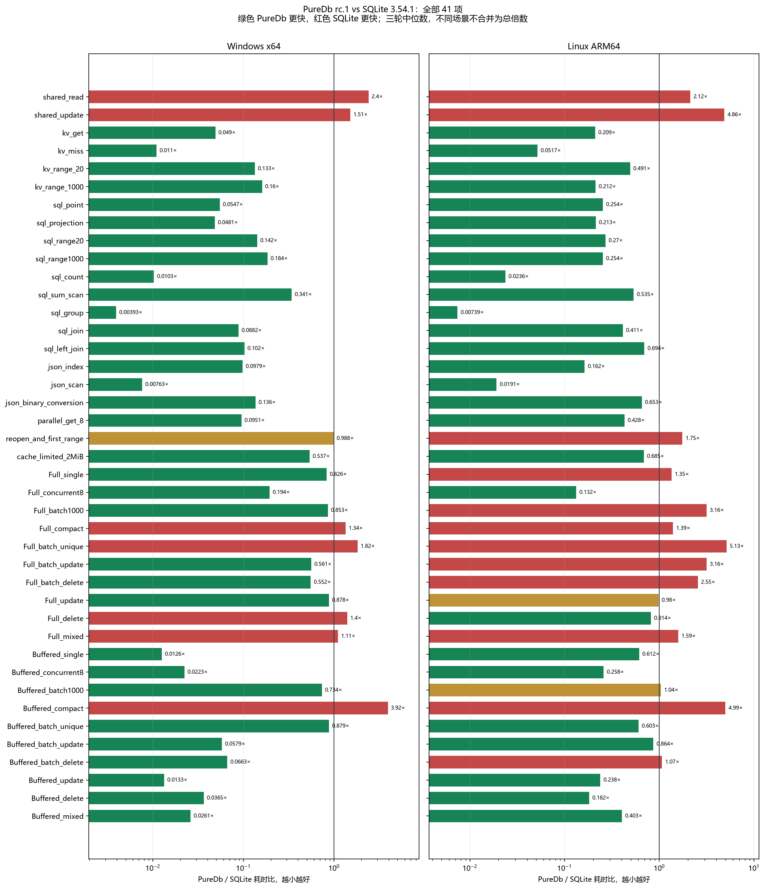
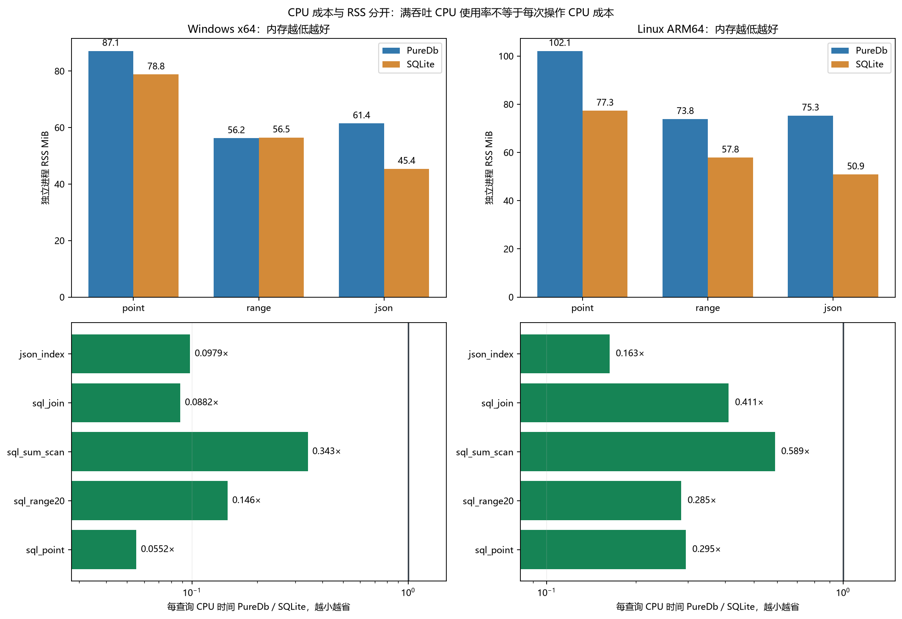

# PureDb rc.1 与 SQLite 全面对照

本报告使用当前候选版冻结内核，重新测量 Windows x64 与 Linux ARM64。数值越低越好，绿色为 PureDb 更快，红色为 SQLite 更快，差距不足 5% 为接近。接近不是统计等价证明。没有隐藏落后项。

[十万 / 百万行及前后对照](SCALE-PERFORMANCE.md) · [稳定性与正式发布评估](PRODUCTION-READINESS.md) · [SQL 支持清单](SQL-SUPPORT.md)

## 测量口径

每平台 41 场景、2 引擎、3 轮，共 246 个主样本；另有 18 个单库独立内存、72 个 ADO 场景样本及 6 个稳态样本。查询预热至少 500 ms、至少 64 次，测量至少 750 ms。顺序轮换引擎，三轮取中位数。没有同时运行其他本轮性能任务。

KV 对 SQLite SQL 的六项比较、SQL 重复查询缓存、参数绑定与结果物化均保留接口成本。Full 和 Buffered 分列；Buffered 与 SQLite WAL/NORMAL 的断电、检查点语义不同。写入计时不含关闭，完整维护成本另外看规模报告。重开是在同一进程内连续 5 次，不是新进程冷启动。

CPU 列是完成同样一次工作消耗的 CPU 时间，包含多进程场景的工作子进程。CPU 总区间不足 100 ms 的项目只给原数值，不按粗粒度计数器排名。独立内存表包含托管及原生 RSS，不能用托管分配量代表 SQLite 总内存。

ARM64 测试盘普通可用空间为 0，root 保留空间仍可写；本轮没有向业务目录写入。该条件会影响落盘耗时，不外推到其他 ARM64 设备。进程 I/O 接口不可用时保留缺测，不伪造零值。

## Windows x64

PureDb 更快 33 项，SQLite 更快 7 项，接近 1 项。不同单位的项目不相加制造一个总性能倍数。

| 场景 | 单位 | PureDb µs | SQLite µs | 耗时胜方 | PureDb CPU µs | SQLite CPU µs | CPU 胜方 |
| --- | --- | --- | --- | --- | --- | --- | --- |
| 四进程读取 | queries | 33.639 | 14.013 | 🟥 SQLite 2.40× | 85.938 | 3.906 | 短区间，不排名 |
| 四进程原子更新 | updates | 202.708 | 133.874 | 🟥 SQLite 1.51× | 148.438 | 31.250 | 🟥 SQLite 4.75× |
| KV 主键命中 | queries | 0.270 | 5.506 | 🟩 PureDb 20.43× | 0.274 | 5.506 | 🟩 PureDb 20.10× |
| KV 主键未命中 | queries | 0.051 | 4.675 | 🟩 PureDb 90.99× | 0.051 | 4.675 | 🟩 PureDb 90.99× |
| KV 范围 20 行 | queries | 2.127 | 15.958 | 🟩 PureDb 7.50× | 2.127 | 15.957 | 🟩 PureDb 7.50× |
| KV 范围 1000 行 | queries | 80.883 | 504.518 | 🟩 PureDb 6.24× | 82.565 | 504.371 | 🟩 PureDb 6.11× |
| SQL 主键完整行 | queries | 0.285 | 5.200 | 🟩 PureDb 18.27× | 0.285 | 5.157 | 🟩 PureDb 18.12× |
| SQL 主键覆盖投影 | queries | 0.237 | 4.927 | 🟩 PureDb 20.77× | 0.238 | 5.028 | 🟩 PureDb 21.14× |
| SQL 范围 20 行 | queries | 2.046 | 14.439 | 🟩 PureDb 7.06× | 2.066 | 14.138 | 🟩 PureDb 6.84× |
| SQL 范围 1000 行 | queries | 90.517 | 491.839 | 🟩 PureDb 5.43× | 90.514 | 501.392 | 🟩 PureDb 5.54× |
| COUNT(*) | queries | 0.179 | 17.457 | 🟩 PureDb 97.32× | 0.179 | 17.821 | 🟩 PureDb 99.34× |
| SUM 扫描 | queries | 999.734 | 2,935.134 | 🟩 PureDb 2.94× | 1,005.362 | 2,929.688 | 🟩 PureDb 2.91× |
| 分组计数 | queries | 16.785 | 4,267.457 | 🟩 PureDb 254.24× | 16.643 | 4,350.142 | 🟩 PureDb 261.37× |
| INNER JOIN | queries | 0.892 | 10.115 | 🟩 PureDb 11.34× | 0.892 | 10.114 | 🟩 PureDb 11.34× |
| LEFT JOIN | queries | 0.718 | 7.015 | 🟩 PureDb 9.77× | 0.718 | 6.967 | 🟩 PureDb 9.70× |
| JSON 表达式索引 | queries | 2.006 | 20.488 | 🟩 PureDb 10.21× | 2.006 | 20.487 | 🟩 PureDb 10.21× |
| JSON 取余计数 | queries | 3.672 | 481.115 | 🟩 PureDb 131.04× | 3.672 | 481.078 | 🟩 PureDb 131.03× |
| JSONB 转换 | queries | 0.781 | 5.756 | 🟩 PureDb 7.37× | 0.797 | 5.876 | 🟩 PureDb 7.37× |
| 八线程 KV 读取 | queries | 0.178 | 1.871 | 🟩 PureDb 10.52× | 1.016 | 13.320 | 🟩 PureDb 13.12× |
| 重开并首次范围查询 | opens | 590.700 | 598.140 | 🟨 接近 | 0.000 | 0.000 | 短区间，不排名 |
| 2 MiB 页缓存读取 | queries | 5.374 | 10.011 | 🟩 PureDb 1.86× | 5.374 | 10.011 | 🟩 PureDb 1.86× |
| Full 逐条新增 | rows | 21,508.524 | 26,026.008 | 🟩 PureDb 1.21× | 3,437.500 | 312.500 | 短区间，不排名 |
| Full 八线程新增 | rows | 6,318.798 | 32,506.044 | 🟩 PureDb 5.14× | 625.000 | 781.250 | 短区间，不排名 |
| Full 批量新增 | rows | 28.260 | 33.115 | 🟩 PureDb 1.17× | 6.250 | 4.688 | 短区间，不排名 |
| Full 压缩 | compactions | 87,076.100 | 64,908.600 | 🟥 SQLite 1.34× | 0.000 | 0.000 | 短区间，不排名 |
| Full 唯一索引批量新增 | rows | 40.423 | 22.252 | 🟥 SQLite 1.82× | 15.625 | 0.000 | 短区间，不排名 |
| Full 批量更新 | rows | 30.341 | 54.130 | 🟩 PureDb 1.78× | 7.812 | 7.812 | 短区间，不排名 |
| Full 批量删除 | rows | 25.295 | 45.786 | 🟩 PureDb 1.81× | 7.812 | 3.125 | 短区间，不排名 |
| Full 逐条更新 | rows | 24,562.128 | 27,990.145 | 🟩 PureDb 1.14× | 937.500 | 156.250 | 短区间，不排名 |
| Full 逐条删除 | rows | 24,804.580 | 17,743.606 | 🟥 SQLite 1.40× | 781.250 | 312.500 | 短区间，不排名 |
| Full 更新加五次读取 | write+5reads | 26,569.295 | 23,995.256 | 🟥 SQLite 1.11× | 625.000 | 312.500 | 短区间，不排名 |
| Buffered 逐条新增 | rows | 5.240 | 416.880 | 🟩 PureDb 79.55× | 0.000 | 62.500 | 短区间，不排名 |
| Buffered 八线程新增 | rows | 7.710 | 345.526 | 🟩 PureDb 44.82× | 15.625 | 31.250 | 短区间，不排名 |
| Buffered 批量新增 | rows | 1.230 | 1.675 | 🟩 PureDb 1.36× | 1.562 | 1.562 | 短区间，不排名 |
| Buffered 压缩 | compactions | 108,455.700 | 27,677.700 | 🟥 SQLite 3.92× | 46,875.000 | 31,250.000 | 短区间，不排名 |
| Buffered 唯一索引批量新增 | rows | 1.409 | 1.604 | 🟩 PureDb 1.14× | 0.000 | 0.000 | 短区间，不排名 |
| Buffered 批量更新 | rows | 1.462 | 25.259 | 🟩 PureDb 17.27× | 1.562 | 6.250 | 短区间，不排名 |
| Buffered 批量删除 | rows | 1.311 | 19.773 | 🟩 PureDb 15.08× | 1.562 | 3.125 | 短区间，不排名 |
| Buffered 逐条更新 | rows | 4.980 | 373.320 | 🟩 PureDb 74.96× | 0.000 | 46.875 | 短区间，不排名 |
| Buffered 逐条删除 | rows | 14.101 | 386.516 | 🟩 PureDb 27.41× | 0.000 | 46.875 | 短区间，不排名 |
| Buffered 更新加五次读取 | write+5reads | 11.066 | 423.954 | 🟩 PureDb 38.31× | 0.000 | 78.125 | 短区间，不排名 |

### 谁的内存更高

| 单库独立场景 | PureDb RSS MiB | SQLite RSS MiB | 谁更高、高多少 |
| --- | --- | --- | --- |
| point | 87.10 | 78.76 | **PureDb 更高**：多 8.34 MiB，高 10.6% |
| range | 56.19 | 56.47 | **SQLite 更高**：多 0.28 MiB，高 0.5% |
| json | 61.43 | 45.36 | **PureDb 更高**：多 16.07 MiB，高 35.4% |

| 主键查询 CPU 指标 | PureDb | SQLite | 解释 |
| --- | --- | --- | --- |
| 整机平均 CPU % | 8.333 | 8.160 | **PureDb 更高**：多 0.17 个百分点，高 2.1% |
| 每次查询 CPU µs | 0.285 | 5.157 | **SQLite 更高**：多 4.87 µs，高 1712.5% |

### 写入与文件占用

下表为计时结束时的逻辑进程 I/O 与打开状态的文件总大小；不含关闭后维护，不等于物理写放大或磁盘忙碌率。-1 表示操作系统没有提供进程 I/O 计数。

| 场景 | PureDb 逻辑写 MiB | SQLite 逻辑写 MiB | PureDb 打开时文件 MiB | SQLite 打开时文件 MiB |
| --- | --- | --- | --- | --- |
| Full 逐条新增 | 0.031 | 0.837 | 0.031 | 0.888 |
| Full 八线程新增 | 0.031 | 1.139 | 0.031 | 1.190 |
| Full 批量新增 | 2.890 | 3.348 | 2.890 | 3.399 |
| Full 压缩 | 1.609 | 1.375 | 1.609 | 4.137 |
| Full 唯一索引批量新增 | 0.289 | 0.303 | 0.290 | 0.361 |
| Full 批量更新 | 2.890 | 10.201 | 5.780 | 7.021 |
| Full 批量删除 | 0.229 | 6.334 | 3.119 | 6.703 |
| Full 逐条更新 | 0.031 | 0.786 | 0.060 | 0.876 |
| Full 逐条删除 | 0.004 | 0.931 | 0.034 | 1.021 |
| Full 更新加五次读取 | 0.031 | 0.786 | 0.060 | 0.876 |
| Buffered 逐条新增 | 0.308 | 8.752 | 0.309 | 4.234 |
| Buffered 八线程新增 | 0.308 | 12.644 | 0.309 | 11.998 |
| Buffered 批量新增 | 2.890 | 3.348 | 2.890 | 3.399 |
| Buffered 压缩 | 1.609 | 1.375 | 1.609 | 4.137 |
| Buffered 唯一索引批量新增 | 0.289 | 0.303 | 0.290 | 0.361 |
| Buffered 批量更新 | 2.890 | 10.201 | 5.780 | 7.021 |
| Buffered 批量删除 | 0.229 | 6.334 | 3.119 | 6.703 |
| Buffered 逐条更新 | 0.308 | 8.304 | 0.598 | 4.250 |
| Buffered 逐条删除 | 0.042 | 10.111 | 0.332 | 4.253 |
| Buffered 更新加五次读取 | 0.308 | 8.304 | 0.598 | 4.250 |

测量内核 SHA-256：`B4E516C14F7CD187587D37C4B9AA6E9AF7C669CC2CA66B4B02FC1F3DDD1E54C0`。原始记录见 [本平台完整数据](../benchmarks/results/candidate/latest/windows)。

### ADO.NET 专项

SQLite 列是同一测试宿主的 SQLite C API 封装，不是 Microsoft.Data.Sqlite 提供程序。

| 场景 | PureDb Core µs | PureDb ADO µs | SQLite C API µs | ADO 相对 SQLite |
| --- | --- | --- | --- | --- |
| point | 0.518 | 1.279 | 5.372 | 🟩 PureDb 4.20× |
| range20 | 3.151 | 4.060 | 14.154 | 🟩 PureDb 3.49× |
| group | 26.045 | 43.763 | 4274.665 | 🟩 PureDb 97.68× |
| join | 1.606 | 2.642 | 10.586 | 🟩 PureDb 4.01× |
| json_scan | 5.472 | 6.198 | 492.912 | 🟩 PureDb 79.52× |
| jsonb | 1.160 | 1.716 | 5.717 | 🟩 PureDb 3.33× |
| insert1000 | 17.756 | 16.654 | 341.476 | 🟩 PureDb 20.50× |
| batch10000 | 4659.530 | 3987.490 | 1627.020 | 🟥 SQLite 2.45× |

### 相同 50 万次主键查询的稳态成本

| 引擎 | 耗时 ms | CPU ms | RSS MiB | 托管存活 MiB |
| --- | --- | --- | --- | --- |
| PureDb | 230.190 | 234.375 | 86.047 | 34.161 |
| SQLite | 2,691.528 | 2,687.500 | 72.730 | 0.257 |

RSS：**PureDb 更高**：多 13.32 MiB，高 18.3%。CPU 时间：**SQLite 更高**：多 2,453.12 ms，高 1046.7%。

## Linux ARM64

PureDb 更快 27 项，SQLite 更快 12 项，接近 2 项。不同单位的项目不相加制造一个总性能倍数。

| 场景 | 单位 | PureDb µs | SQLite µs | 耗时胜方 | PureDb CPU µs | SQLite CPU µs | CPU 胜方 |
| --- | --- | --- | --- | --- | --- | --- | --- |
| 四进程读取 | queries | 89.768 | 42.348 | 🟥 SQLite 2.12× | 207.355 | 33.524 | 🟥 SQLite 6.19× |
| 四进程原子更新 | updates | 316.470 | 65.155 | 🟥 SQLite 4.86× | 421.592 | 34.417 | 🟥 SQLite 12.25× |
| KV 主键命中 | queries | 0.969 | 4.627 | 🟩 PureDb 4.77× | 0.994 | 4.846 | 🟩 PureDb 4.87× |
| KV 主键未命中 | queries | 0.121 | 2.343 | 🟩 PureDb 19.35× | 0.124 | 2.429 | 🟩 PureDb 19.61× |
| KV 范围 20 行 | queries | 14.764 | 30.093 | 🟩 PureDb 2.04× | 17.210 | 30.480 | 🟩 PureDb 1.77× |
| KV 范围 1000 行 | queries | 223.177 | 1,052.205 | 🟩 PureDb 4.71× | 229.248 | 1,057.969 | 🟩 PureDb 4.61× |
| SQL 主键完整行 | queries | 0.894 | 3.525 | 🟩 PureDb 3.94× | 1.043 | 3.534 | 🟩 PureDb 3.39× |
| SQL 主键覆盖投影 | queries | 0.621 | 2.920 | 🟩 PureDb 4.70× | 0.622 | 2.987 | 🟩 PureDb 4.80× |
| SQL 范围 20 行 | queries | 5.599 | 20.770 | 🟩 PureDb 3.71× | 5.972 | 20.986 | 🟩 PureDb 3.51× |
| SQL 范围 1000 行 | queries | 252.297 | 995.225 | 🟩 PureDb 3.94× | 254.558 | 1,004.737 | 🟩 PureDb 3.95× |
| COUNT(*) | queries | 0.488 | 20.640 | 🟩 PureDb 42.32× | 0.488 | 20.642 | 🟩 PureDb 42.32× |
| SUM 扫描 | queries | 2,830.337 | 5,290.256 | 🟩 PureDb 1.87× | 3,115.662 | 5,291.232 | 🟩 PureDb 1.70× |
| 分组计数 | queries | 54.600 | 7,393.059 | 🟩 PureDb 135.40× | 55.664 | 7,692.637 | 🟩 PureDb 138.20× |
| INNER JOIN | queries | 5.177 | 12.585 | 🟩 PureDb 2.43× | 5.178 | 12.587 | 🟩 PureDb 2.43× |
| LEFT JOIN | queries | 4.841 | 6.971 | 🟩 PureDb 1.44× | 4.846 | 6.972 | 🟩 PureDb 1.44× |
| JSON 表达式索引 | queries | 5.058 | 31.143 | 🟩 PureDb 6.16× | 5.076 | 31.163 | 🟩 PureDb 6.14× |
| JSON 取余计数 | queries | 13.049 | 683.764 | 🟩 PureDb 52.40× | 13.062 | 693.062 | 🟩 PureDb 53.06× |
| JSONB 转换 | queries | 2.655 | 4.066 | 🟩 PureDb 1.53× | 2.726 | 4.259 | 🟩 PureDb 1.56× |
| 八线程 KV 读取 | queries | 0.733 | 1.714 | 🟩 PureDb 2.34× | 2.574 | 7.669 | 🟩 PureDb 2.98× |
| 重开并首次范围查询 | opens | 725.140 | 413.580 | 🟥 SQLite 1.75× | 747.600 | 429.600 | 短区间，不排名 |
| 2 MiB 页缓存读取 | queries | 4.297 | 6.277 | 🟩 PureDb 1.46× | 4.300 | 6.276 | 🟩 PureDb 1.46× |
| Full 逐条新增 | rows | 1,370.139 | 1,015.473 | 🟥 SQLite 1.35× | 1,078.140 | 270.400 | 短区间，不排名 |
| Full 八线程新增 | rows | 268.941 | 2,031.402 | 🟩 PureDb 7.55× | 314.700 | 408.960 | 短区间，不排名 |
| Full 批量新增 | rows | 32.819 | 10.397 | 🟥 SQLite 3.16× | 44.613 | 8.358 | 短区间，不排名 |
| Full 压缩 | compactions | 28,441.400 | 20,418.700 | 🟥 SQLite 1.39× | 23,705.000 | 13,736.000 | 短区间，不排名 |
| Full 唯一索引批量新增 | rows | 26.497 | 5.170 | 🟥 SQLite 5.13× | 24.148 | 3.159 | 短区间，不排名 |
| Full 批量更新 | rows | 23.959 | 7.582 | 🟥 SQLite 3.16× | 25.745 | 4.310 | 短区间，不排名 |
| Full 批量删除 | rows | 16.575 | 6.502 | 🟥 SQLite 2.55× | 26.058 | 3.396 | 短区间，不排名 |
| Full 逐条更新 | rows | 895.500 | 913.980 | 🟨 接近 | 504.450 | 973.530 | 短区间，不排名 |
| Full 逐条删除 | rows | 895.025 | 1,099.468 | 🟩 PureDb 1.23× | 499.820 | 313.300 | 短区间，不排名 |
| Full 更新加五次读取 | write+5reads | 1,739.308 | 1,096.056 | 🟥 SQLite 1.59× | 1,151.700 | 189.430 | 短区间，不排名 |
| Buffered 逐条新增 | rows | 43.117 | 70.465 | 🟩 PureDb 1.63× | 43.299 | 60.785 | 短区间，不排名 |
| Buffered 八线程新增 | rows | 44.234 | 171.408 | 🟩 PureDb 3.88× | 98.949 | 120.837 | 短区间，不排名 |
| Buffered 批量新增 | rows | 9.165 | 8.813 | 🟨 接近 | 11.515 | 8.787 | 短区间，不排名 |
| Buffered 压缩 | compactions | 98,018.700 | 19,655.700 | 🟥 SQLite 4.99× | 126,885.000 | 18,650.000 | 短区间，不排名 |
| Buffered 唯一索引批量新增 | rows | 3.709 | 6.148 | 🟩 PureDb 1.66× | 3.993 | 6.493 | 短区间，不排名 |
| Buffered 批量更新 | rows | 7.820 | 9.050 | 🟩 PureDb 1.16× | 8.060 | 13.084 | 短区间，不排名 |
| Buffered 批量删除 | rows | 5.734 | 5.369 | 🟥 SQLite 1.07× | 5.763 | 5.274 | 短区间，不排名 |
| Buffered 逐条更新 | rows | 18.994 | 79.814 | 🟩 PureDb 4.20× | 34.203 | 31.149 | 短区间，不排名 |
| Buffered 逐条删除 | rows | 16.676 | 91.876 | 🟩 PureDb 5.51× | 18.676 | 75.728 | 短区间，不排名 |
| Buffered 更新加五次读取 | write+5reads | 40.905 | 101.585 | 🟩 PureDb 2.48× | 70.623 | 119.519 | 短区间，不排名 |

### 谁的内存更高

| 单库独立场景 | PureDb RSS MiB | SQLite RSS MiB | 谁更高、高多少 |
| --- | --- | --- | --- |
| point | 102.10 | 77.28 | **PureDb 更高**：多 24.82 MiB，高 32.1% |
| range | 73.83 | 57.85 | **PureDb 更高**：多 15.98 MiB，高 27.6% |
| json | 75.27 | 50.86 | **PureDb 更高**：多 24.41 MiB，高 48.0% |

| 主键查询 CPU 指标 | PureDb | SQLite | 解释 |
| --- | --- | --- | --- |
| 整机平均 CPU % | 14.580 | 12.533 | **PureDb 更高**：多 2.05 个百分点，高 16.3% |
| 每次查询 CPU µs | 1.043 | 3.534 | **SQLite 更高**：多 2.49 µs，高 238.8% |

### 写入与文件占用

下表为计时结束时的逻辑进程 I/O 与打开状态的文件总大小；不含关闭后维护，不等于物理写放大或磁盘忙碌率。-1 表示操作系统没有提供进程 I/O 计数。

| 场景 | PureDb 逻辑写 MiB | SQLite 逻辑写 MiB | PureDb 打开时文件 MiB | SQLite 打开时文件 MiB |
| --- | --- | --- | --- | --- |
| Full 逐条新增 | 未提供 | 未提供 | 0.031 | 0.888 |
| Full 八线程新增 | 未提供 | 未提供 | 0.031 | 1.143 |
| Full 批量新增 | 未提供 | 未提供 | 2.890 | 3.399 |
| Full 压缩 | 未提供 | 未提供 | 1.609 | 4.137 |
| Full 唯一索引批量新增 | 未提供 | 未提供 | 0.290 | 0.361 |
| Full 批量更新 | 未提供 | 未提供 | 5.780 | 7.021 |
| Full 批量删除 | 未提供 | 未提供 | 3.119 | 6.703 |
| Full 逐条更新 | 未提供 | 未提供 | 0.060 | 0.876 |
| Full 逐条删除 | 未提供 | 未提供 | 0.034 | 1.021 |
| Full 更新加五次读取 | 未提供 | 未提供 | 0.060 | 0.876 |
| Buffered 逐条新增 | 未提供 | 未提供 | 0.309 | 4.234 |
| Buffered 八线程新增 | 未提供 | 未提供 | 0.309 | 6.776 |
| Buffered 批量新增 | 未提供 | 未提供 | 2.890 | 3.399 |
| Buffered 压缩 | 未提供 | 未提供 | 1.609 | 4.137 |
| Buffered 唯一索引批量新增 | 未提供 | 未提供 | 0.290 | 0.361 |
| Buffered 批量更新 | 未提供 | 未提供 | 5.780 | 7.021 |
| Buffered 批量删除 | 未提供 | 未提供 | 3.119 | 6.703 |
| Buffered 逐条更新 | 未提供 | 未提供 | 0.598 | 4.250 |
| Buffered 逐条删除 | 未提供 | 未提供 | 0.332 | 4.253 |
| Buffered 更新加五次读取 | 未提供 | 未提供 | 0.598 | 4.250 |

测量内核 SHA-256：`B4E516C14F7CD187587D37C4B9AA6E9AF7C669CC2CA66B4B02FC1F3DDD1E54C0`。原始记录见 [本平台完整数据](../benchmarks/results/candidate/latest/linux)。

### ADO.NET 专项

SQLite 列是同一测试宿主的 SQLite C API 封装，不是 Microsoft.Data.Sqlite 提供程序。

| 场景 | PureDb Core µs | PureDb ADO µs | SQLite C API µs | ADO 相对 SQLite |
| --- | --- | --- | --- | --- |
| point | 2.880 | 10.690 | 4.014 | 🟥 SQLite 2.66× |
| range20 | 9.106 | 14.631 | 20.851 | 🟩 PureDb 1.43× |
| group | 78.397 | 140.929 | 7454.521 | 🟩 PureDb 52.90× |
| join | 6.957 | 10.032 | 14.041 | 🟩 PureDb 1.40× |
| json_scan | 17.496 | 20.961 | 682.419 | 🟩 PureDb 32.56× |
| jsonb | 6.159 | 7.909 | 3.936 | 🟥 SQLite 2.01× |
| insert1000 | 31.049 | 36.113 | 60.636 | 🟩 PureDb 1.68× |
| batch10000 | 10570.830 | 10281.110 | 3015.790 | 🟥 SQLite 3.41× |

### 相同 50 万次主键查询的稳态成本

| 引擎 | 耗时 ms | CPU ms | RSS MiB | 托管存活 MiB |
| --- | --- | --- | --- | --- |
| PureDb | 973.260 | 973.351 | 97.656 | 33.952 |
| SQLite | 2,227.749 | 2,254.293 | 68.898 | 0.076 |

RSS：**PureDb 更高**：多 28.76 MiB，高 41.7%。CPU 时间：**SQLite 更高**：多 1,280.94 ms，高 131.6%。

## 结论

按上表逐项判断。读取、批量、强制刷盘、并发、CPU 成本、RSS 和文件占用没有共同的单一胜方；规模测试中已经明确保留 SQLite 更好的项。当前候选版没有达到所有指标全面超越 SQLite，也没有提供完整 SQLite 文件协议和 SQL 方言。

## 复算

运行 `python scripts/make-candidate-report.py` 从仓库 JSON 复算表格。完整套件见 `scripts/run-benchmarks.py`，规模配对见 `scripts/run-scale-pair.py`；测试用原生 SQLite 仅属于基准宿主，两个产品包保持纯托管。
