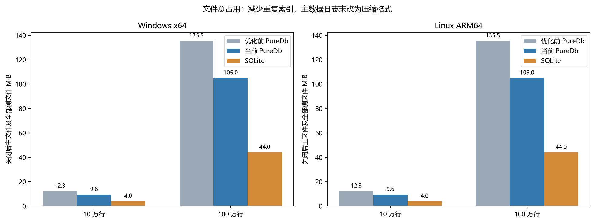

# PureDb rc.1：十万与百万行、文件大小及优化前后对照

同一测试宿主分别加载优化前 preview.3 源码构建、当前 rc.1 冻结构建和原版 SQLite 3.54.1；两平台使用同一组托管 DLL。每个规模、每轮、每种引擎使用独立进程与新文件，串行轮换三轮。

[当前完整 41 项对照](RC-PERFORMANCE.md) · [稳定性与发布评估](PRODUCTION-READINESS.md)

## 数据与边界

表结构为 INTEGER 主键、INTEGER 数值及固定 UTF-8 中英文文本。按 1000 行一个事务导入 10 万 / 100 万行；两边页缓存预算均为 64 MiB，PureDb 额外的 SQL 缓存预算为 64 MiB。关闭 PureDb 周期检查点以分开测量显式维护，因此导入数字不等于生产默认自动检查点配置的完整成本。PureDb 为 Buffered，SQLite 为 WAL/NORMAL。

范围查询分为含首次编译和页面载入的 30 次区间，以及至少 500 ms 预热后的 10000 次稳定查询。热查询中 SQLite 复用 prepared statement，双方物化两列、20 行结果。更新、删除各执行一条半开主键区间语句，保留原有约束及触发器路径。最大实测规模为一百万行，不代表亿级、超内存、TB 级或完整 SQLite 方言。

每项耗时为表中整个工作量的总毫秒数。RSS 为相同阶段结束时的进程采样，包含先前阶段和 GC 保留页，不能当成该语句独占内存或最大峰值。托管累计分配只用于 PureDb 前后对照；SQLite 的原生分配不计入其中。

## Windows x64

### 100,000 行

| 场景与工作量 | 优化前 ms | 当前 ms | SQLite ms | 当前相对旧版 | 当前与 SQLite |
| --- | --- | --- | --- | --- | --- |
| 批量新增全部行 | 394.626 | 371.849 | 277.210 | 快 1.06×，减少 5.8% | 🟥 SQLite 1.34× |
| 导入后范围查询 30 次（含首查） | 314.876 | 33.222 | 1.454 | 快 9.48×，减少 89.4% | 🟥 SQLite 22.85× |
| 显式检查点 | 115.152 | 228.884 | 111.235 | 慢 1.99×，增加 98.8% | 🟥 SQLite 2.06× |
| 检查点后范围查询 30 次（含首查） | 0.403 | 5.158 | 0.533 | 慢 12.80×，增加 1180.4% | 🟥 SQLite 9.67× |
| 预热后范围查询 10000 次 | 114.568 | 114.373 | 68.868 | 快 1.00×，减少 0.2% | 🟥 SQLite 1.66× |
| 半开区间更新 10000 行 | 138.518 | 38.703 | 31.237 | 快 3.58×，减少 72.1% | 🟥 SQLite 1.24× |
| 半开区间删除 10000 行 | 80.957 | 11.068 | 2.637 | 快 7.31×，减少 86.3% | 🟥 SQLite 4.20× |
| 压缩 | 164.589 | 272.943 | 192.063 | 慢 1.66×，增加 65.8% | 🟥 SQLite 1.42× |
| 关闭 | 135.362 | 7.319 | 1.672 | 快 18.49×，减少 94.6% | 🟥 SQLite 4.38× |
| 重开并首次范围查询 | 185.848 | 1.212 | 1.081 | 快 153.30×，减少 99.3% | 🟥 SQLite 1.12× |
| 主键查询 10000 次 | 11.620 | 12.416 | 58.921 | 慢 1.07×，增加 6.9% | 🟩 PureDb 4.75× |

#### CPU 与 RSS：相同工作量、相同阶段

| 场景 | 当前 CPU ms | SQLite CPU ms | 当前 RSS MiB | SQLite RSS MiB | 谁的内存更高 |
| --- | --- | --- | --- | --- | --- |
| 批量新增全部行 | 453.125 | 93.750 | 63.18 | 37.03 | **PureDb 更高**：多 26.16 MiB，高 70.6% |
| 导入后范围查询 30 次（含首查） | 31.250 | 0.000 | 63.15 | 37.18 | **PureDb 更高**：多 25.97 MiB，高 69.9% |
| 显式检查点 | 46.875 | 0.000 | 64.46 | 37.23 | **PureDb 更高**：多 27.23 MiB，高 73.2% |
| 检查点后范围查询 30 次（含首查） | 0.000 | 0.000 | 47.59 | 36.84 | **PureDb 更高**：多 10.75 MiB，高 29.2% |
| 预热后范围查询 10000 次 | 125.000 | 78.125 | 73.71 | 44.52 | **PureDb 更高**：多 29.20 MiB，高 65.6% |
| 半开区间更新 10000 行 | 31.250 | 0.000 | 71.54 | 44.53 | **PureDb 更高**：多 27.01 MiB，高 60.6% |
| 半开区间删除 10000 行 | 15.625 | 0.000 | 67.90 | 44.54 | **PureDb 更高**：多 23.36 MiB，高 52.4% |
| 压缩 | 93.750 | 15.625 | 76.97 | 44.68 | **PureDb 更高**：多 32.29 MiB，高 72.3% |
| 关闭 | 0.000 | 0.000 | 51.08 | 36.16 | **PureDb 更高**：多 14.92 MiB，高 41.3% |
| 重开并首次范围查询 | 0.000 | 0.000 | 51.11 | 34.32 | **PureDb 更高**：多 16.80 MiB，高 48.9% |
| 主键查询 10000 次 | 0.000 | 62.500 | 54.14 | 35.73 | **PureDb 更高**：多 18.41 MiB，高 51.5% |

#### PureDb 分配变化

| 场景 | 优化前累计托管分配 MiB | 当前累计托管分配 MiB | 前后变化 |
| --- | --- | --- | --- |
| 批量新增全部行 | 154.119 | 149.225 | 快 1.03×，减少 3.2% |
| 导入后范围查询 30 次（含首查） | 44.920 | 1.158 | 快 38.78×，减少 97.4% |
| 显式检查点 | 13.426 | 0.086 | 快 155.94×，减少 99.4% |
| 检查点后范围查询 30 次（含首查） | 0.064 | 0.408 | 慢 6.34×，增加 533.8% |
| 预热后范围查询 10000 次 | 55.025 | 55.797 | 慢 1.01×，增加 1.4% |
| 半开区间更新 10000 行 | 46.942 | 10.306 | 快 4.55×，减少 78.0% |
| 半开区间删除 10000 行 | 36.784 | 8.415 | 快 4.37×，减少 77.1% |
| 压缩 | 16.995 | 17.551 | 慢 1.03×，增加 3.3% |
| 关闭 | 18.104 | 0.018 | 快 994.52×，减少 99.9% |
| 重开并首次范围查询 | 29.246 | 0.121 | 快 240.71×，减少 99.6% |
| 主键查询 10000 次 | 2.948 | 2.973 | 慢 1.01×，增加 0.9% |

CPU 高低的明确比较（总 CPU 时间至少 100 ms）：

| 场景 | 当前 CPU ms | SQLite CPU ms | 谁高、高多少 |
| --- | --- | --- | --- |

其余短区间 CPU 只展示原值，不用量化误差推断高低。更充分的查询 CPU 对照见完整 41 项表。

压缩加关闭的合计中位数：旧版 **308.155 ms**，当前 **280.207 ms**，SQLite **193.684 ms**。当前压缩已包含新主索引落盘，旧版有一部分在关闭阶段完成；不能只比较单独压缩项。

| 关闭后文件 | 优化前 MiB | 当前 MiB | SQLite MiB | 当前与 SQLite |
| --- | --- | --- | --- | --- |
| 主数据文件 | 6.781 | 6.781 | 4.000 | **PureDb 更高**：多 2.78 MiB，高 69.5% |
| 主文件及全部侧文件 | 12.336 | 9.559 | 4.000 | **PureDb 更高**：多 5.56 MiB，高 139.0% |

本组新建文件总占用相对旧版减少 **22.5%**。主数据日志没有改变编码或压缩，主要收益来自不再生成重复主键索引。已有旧库遗留的主键侧文件不会在打开时自动删除；不能把新建样本收益直接当成所有旧库已缩小。

### 1,000,000 行

| 场景与工作量 | 优化前 ms | 当前 ms | SQLite ms | 当前相对旧版 | 当前与 SQLite |
| --- | --- | --- | --- | --- | --- |
| 批量新增全部行 | 1,663.299 | 1,569.653 | 3,807.791 | 快 1.06×，减少 5.6% | 🟩 PureDb 2.43× |
| 导入后范围查询 30 次（含首查） | 1,519.592 | 36.860 | 1.285 | 快 41.23×，减少 97.6% | 🟥 SQLite 28.69× |
| 显式检查点 | 1,368.733 | 1,292.391 | 174.216 | 快 1.06×，减少 5.6% | 🟥 SQLite 7.42× |
| 检查点后范围查询 30 次（含首查） | 0.261 | 5.024 | 0.509 | 慢 19.26×，增加 1826.2% | 🟥 SQLite 9.86× |
| 预热后范围查询 10000 次 | 184.664 | 156.645 | 70.145 | 快 1.18×，减少 15.2% | 🟥 SQLite 2.23× |
| 半开区间更新 10000 行 | 1,233.221 | 30.951 | 29.483 | 快 39.84×，减少 97.5% | 🟨 接近 |
| 半开区间删除 10000 行 | 941.673 | 13.437 | 2.642 | 快 70.08×，减少 98.6% | 🟥 SQLite 5.09× |
| 压缩 | 1,166.624 | 1,850.633 | 1,454.042 | 慢 1.59×，增加 58.6% | 🟥 SQLite 1.27× |
| 关闭 | 539.770 | 7.489 | 6.998 | 快 72.08×，减少 98.6% | 🟥 SQLite 1.07× |
| 重开并首次范围查询 | 1,132.633 | 1.122 | 1.193 | 快 1009.21×，减少 99.9% | 🟩 PureDb 1.06× |
| 主键查询 10000 次 | 10.894 | 11.418 | 57.818 | 慢 1.05×，增加 4.8% | 🟩 PureDb 5.06× |

#### CPU 与 RSS：相同工作量、相同阶段

| 场景 | 当前 CPU ms | SQLite CPU ms | 当前 RSS MiB | SQLite RSS MiB | 谁的内存更高 |
| --- | --- | --- | --- | --- | --- |
| 批量新增全部行 | 1,625.000 | 656.250 | 116.68 | 82.89 | **PureDb 更高**：多 33.79 MiB，高 40.8% |
| 导入后范围查询 30 次（含首查） | 46.875 | 0.000 | 123.73 | 83.04 | **PureDb 更高**：多 40.69 MiB，高 49.0% |
| 显式检查点 | 140.625 | 15.625 | 124.78 | 83.08 | **PureDb 更高**：多 41.70 MiB，高 50.2% |
| 检查点后范围查询 30 次（含首查） | 0.000 | 0.000 | 103.39 | 82.70 | **PureDb 更高**：多 20.69 MiB，高 25.0% |
| 预热后范围查询 10000 次 | 156.250 | 62.500 | 125.58 | 90.32 | **PureDb 更高**：多 35.26 MiB，高 39.0% |
| 半开区间更新 10000 行 | 31.250 | 0.000 | 125.71 | 90.33 | **PureDb 更高**：多 35.38 MiB，高 39.2% |
| 半开区间删除 10000 行 | 15.625 | 0.000 | 126.12 | 90.34 | **PureDb 更高**：多 35.78 MiB，高 39.6% |
| 压缩 | 593.750 | 296.875 | 220.08 | 91.14 | **PureDb 更高**：多 128.95 MiB，高 141.5% |
| 关闭 | 0.000 | 0.000 | 86.40 | 36.28 | **PureDb 更高**：多 50.12 MiB，高 138.1% |
| 重开并首次范围查询 | 0.000 | 0.000 | 86.42 | 34.51 | **PureDb 更高**：多 51.91 MiB，高 150.4% |
| 主键查询 10000 次 | 15.625 | 62.500 | 86.46 | 35.94 | **PureDb 更高**：多 50.52 MiB，高 140.6% |

#### PureDb 分配变化

| 场景 | 优化前累计托管分配 MiB | 当前累计托管分配 MiB | 前后变化 |
| --- | --- | --- | --- |
| 批量新增全部行 | 1,418.440 | 1,346.148 | 快 1.05×，减少 5.1% |
| 导入后范围查询 30 次（含首查） | 432.149 | 8.022 | 快 53.87×，减少 98.1% |
| 显式检查点 | 133.589 | 0.086 | 快 1552.15×，减少 99.9% |
| 检查点后范围查询 30 次（含首查） | 0.064 | 0.360 | 慢 5.59×，增加 458.9% |
| 预热后范围查询 10000 次 | 99.280 | 87.989 | 快 1.13×，减少 11.4% |
| 半开区间更新 10000 行 | 480.027 | 11.398 | 快 42.11×，减少 97.6% |
| 半开区间删除 10000 行 | 449.060 | 9.018 | 快 49.80×，减少 98.0% |
| 压缩 | 184.144 | 208.252 | 慢 1.13×，增加 13.1% |
| 关闭 | 180.267 | 0.042 | 快 4324.30×，减少 100.0% |
| 重开并首次范围查询 | 321.648 | 0.121 | 快 2647.35×，减少 100.0% |
| 主键查询 10000 次 | 3.043 | 2.973 | 快 1.02×，减少 2.3% |

CPU 高低的明确比较（总 CPU 时间至少 100 ms）：

| 场景 | 当前 CPU ms | SQLite CPU ms | 谁高、高多少 |
| --- | --- | --- | --- |
| 批量新增全部行 | 1625.000 | 656.250 | **PureDb 更高**：多 968.75 ms，高 147.6% |
| 压缩 | 593.750 | 296.875 | **PureDb 更高**：多 296.88 ms，高 100.0% |

其余短区间 CPU 只展示原值，不用量化误差推断高低。更充分的查询 CPU 对照见完整 41 项表。

压缩加关闭的合计中位数：旧版 **1,692.396 ms**，当前 **1,857.837 ms**，SQLite **1,460.967 ms**。当前压缩已包含新主索引落盘，旧版有一部分在关闭阶段完成；不能只比较单独压缩项。

| 关闭后文件 | 优化前 MiB | 当前 MiB | SQLite MiB | 当前与 SQLite |
| --- | --- | --- | --- | --- |
| 主数据文件 | 74.589 | 74.589 | 44.047 | **PureDb 更高**：多 30.54 MiB，高 69.3% |
| 主文件及全部侧文件 | 135.511 | 105.050 | 44.047 | **PureDb 更高**：多 61.00 MiB，高 138.5% |

本组新建文件总占用相对旧版减少 **22.5%**。主数据日志没有改变编码或压缩，主要收益来自不再生成重复主键索引。已有旧库遗留的主键侧文件不会在打开时自动删除；不能把新建样本收益直接当成所有旧库已缩小。

## Linux ARM64

### 100,000 行

| 场景与工作量 | 优化前 ms | 当前 ms | SQLite ms | 当前相对旧版 | 当前与 SQLite |
| --- | --- | --- | --- | --- | --- |
| 批量新增全部行 | 684.540 | 724.664 | 231.407 | 慢 1.06×，增加 5.9% | 🟥 SQLite 3.13× |
| 导入后范围查询 30 次（含首查） | 511.017 | 57.527 | 3.607 | 快 8.88×，减少 88.7% | 🟥 SQLite 15.95× |
| 显式检查点 | 144.673 | 193.817 | 20.841 | 慢 1.34×，增加 34.0% | 🟥 SQLite 9.30× |
| 检查点后范围查询 30 次（含首查） | 1.143 | 9.780 | 0.951 | 慢 8.56×，增加 755.6% | 🟥 SQLite 10.28× |
| 预热后范围查询 10000 次 | 469.324 | 421.141 | 104.069 | 快 1.11×，减少 10.3% | 🟥 SQLite 4.05× |
| 半开区间更新 10000 行 | 465.045 | 86.709 | 5.799 | 快 5.36×，减少 81.4% | 🟥 SQLite 14.95× |
| 半开区间删除 10000 行 | 283.310 | 34.094 | 4.045 | 快 8.31×，减少 88.0% | 🟥 SQLite 8.43× |
| 压缩 | 152.119 | 250.741 | 73.664 | 慢 1.65×，增加 64.8% | 🟥 SQLite 3.40× |
| 关闭 | 132.215 | 27.426 | 2.186 | 快 4.82×，减少 79.3% | 🟥 SQLite 12.55× |
| 重开并首次范围查询 | 213.228 | 5.129 | 0.734 | 快 41.58×，减少 97.6% | 🟥 SQLite 6.99× |
| 主键查询 10000 次 | 23.779 | 44.357 | 41.569 | 慢 1.87×，增加 86.5% | 🟥 SQLite 1.07× |

#### CPU 与 RSS：相同工作量、相同阶段

| 场景 | 当前 CPU ms | SQLite CPU ms | 当前 RSS MiB | SQLite RSS MiB | 谁的内存更高 |
| --- | --- | --- | --- | --- | --- |
| 批量新增全部行 | 1,157.629 | 247.814 | 80.65 | 41.53 | **PureDb 更高**：多 39.12 MiB，高 94.2% |
| 导入后范围查询 30 次（含首查） | 57.576 | 3.649 | 81.39 | 43.29 | **PureDb 更高**：多 38.11 MiB，高 88.0% |
| 显式检查点 | 113.864 | 7.457 | 81.91 | 43.40 | **PureDb 更高**：多 38.51 MiB，高 88.7% |
| 检查点后范围查询 30 次（含首查） | 9.841 | 0.967 | 62.68 | 43.42 | **PureDb 更高**：多 19.26 MiB，高 44.4% |
| 预热后范围查询 10000 次 | 590.874 | 104.191 | 90.18 | 47.22 | **PureDb 更高**：多 42.95 MiB，高 91.0% |
| 半开区间更新 10000 行 | 88.775 | 4.654 | 76.11 | 47.22 | **PureDb 更高**：多 28.89 MiB，高 61.2% |
| 半开区间删除 10000 行 | 34.180 | 4.069 | 79.01 | 47.22 | **PureDb 更高**：多 31.79 MiB，高 67.3% |
| 压缩 | 235.495 | 41.251 | 90.82 | 47.34 | **PureDb 更高**：多 43.48 MiB，高 91.8% |
| 关闭 | 33.021 | 2.220 | 63.19 | 45.98 | **PureDb 更高**：多 17.21 MiB，高 37.4% |
| 重开并首次范围查询 | 5.193 | 0.758 | 63.26 | 45.98 | **PureDb 更高**：多 17.28 MiB，高 37.6% |
| 主键查询 10000 次 | 44.413 | 41.405 | 66.26 | 48.24 | **PureDb 更高**：多 18.02 MiB，高 37.3% |

#### PureDb 分配变化

| 场景 | 优化前累计托管分配 MiB | 当前累计托管分配 MiB | 前后变化 |
| --- | --- | --- | --- |
| 批量新增全部行 | 147.124 | 141.711 | 快 1.04×，减少 3.7% |
| 导入后范围查询 30 次（含首查） | 46.210 | 1.169 | 快 39.54×，减少 97.5% |
| 显式检查点 | 13.425 | 0.082 | 快 163.33×，减少 99.4% |
| 检查点后范围查询 30 次（含首查） | 0.064 | 0.378 | 慢 5.95×，增加 495.3% |
| 预热后范围查询 10000 次 | 57.636 | 58.672 | 慢 1.02×，增加 1.8% |
| 半开区间更新 10000 行 | 49.065 | 10.212 | 快 4.80×，减少 79.2% |
| 半开区间删除 10000 行 | 37.794 | 8.908 | 快 4.24×，减少 76.4% |
| 压缩 | 16.999 | 18.172 | 慢 1.07×，增加 6.9% |
| 关闭 | 18.096 | 0.008 | 快 2194.21×，减少 100.0% |
| 重开并首次范围查询 | 29.788 | 0.120 | 快 247.93×，减少 99.6% |
| 主键查询 10000 次 | 2.936 | 2.972 | 慢 1.01×，增加 1.2% |

CPU 高低的明确比较（总 CPU 时间至少 100 ms）：

| 场景 | 当前 CPU ms | SQLite CPU ms | 谁高、高多少 |
| --- | --- | --- | --- |
| 批量新增全部行 | 1157.629 | 247.814 | **PureDb 更高**：多 909.82 ms，高 367.1% |
| 预热后范围查询 10000 次 | 590.874 | 104.191 | **PureDb 更高**：多 486.68 ms，高 467.1% |

其余短区间 CPU 只展示原值，不用量化误差推断高低。更充分的查询 CPU 对照见完整 41 项表。

压缩加关闭的合计中位数：旧版 **337.344 ms**，当前 **283.445 ms**，SQLite **75.849 ms**。当前压缩已包含新主索引落盘，旧版有一部分在关闭阶段完成；不能只比较单独压缩项。

| 关闭后文件 | 优化前 MiB | 当前 MiB | SQLite MiB | 当前与 SQLite |
| --- | --- | --- | --- | --- |
| 主数据文件 | 6.781 | 6.781 | 4.000 | **PureDb 更高**：多 2.78 MiB，高 69.5% |
| 主文件及全部侧文件 | 12.336 | 9.559 | 4.000 | **PureDb 更高**：多 5.56 MiB，高 139.0% |

本组新建文件总占用相对旧版减少 **22.5%**。主数据日志没有改变编码或压缩，主要收益来自不再生成重复主键索引。已有旧库遗留的主键侧文件不会在打开时自动删除；不能把新建样本收益直接当成所有旧库已缩小。

### 1,000,000 行

| 场景与工作量 | 优化前 ms | 当前 ms | SQLite ms | 当前相对旧版 | 当前与 SQLite |
| --- | --- | --- | --- | --- | --- |
| 批量新增全部行 | 3,088.916 | 2,694.366 | 2,009.592 | 快 1.15×，减少 12.8% | 🟥 SQLite 1.34× |
| 导入后范围查询 30 次（含首查） | 2,636.286 | 69.799 | 2.632 | 快 37.77×，减少 97.4% | 🟥 SQLite 26.52× |
| 显式检查点 | 763.356 | 815.261 | 32.142 | 慢 1.07×，增加 6.8% | 🟥 SQLite 25.36× |
| 检查点后范围查询 30 次（含首查） | 2.273 | 19.751 | 1.056 | 慢 8.69×，增加 768.8% | 🟥 SQLite 18.71× |
| 预热后范围查询 10000 次 | 473.330 | 468.341 | 120.425 | 快 1.01×，减少 1.1% | 🟥 SQLite 3.89× |
| 半开区间更新 10000 行 | 2,369.956 | 67.431 | 5.951 | 快 35.15×，减少 97.2% | 🟥 SQLite 11.33× |
| 半开区间删除 10000 行 | 1,963.063 | 32.447 | 4.449 | 快 60.50×，减少 98.3% | 🟥 SQLite 7.29× |
| 压缩 | 934.873 | 2,068.997 | 819.500 | 慢 2.21×，增加 121.3% | 🟥 SQLite 2.52× |
| 关闭 | 412.207 | 18.307 | 9.032 | 快 22.52×，减少 95.6% | 🟥 SQLite 2.03× |
| 重开并首次范围查询 | 1,873.025 | 2.734 | 1.078 | 快 685.11×，减少 99.9% | 🟥 SQLite 2.54× |
| 主键查询 10000 次 | 22.474 | 30.872 | 69.483 | 慢 1.37×，增加 37.4% | 🟩 PureDb 2.25× |

#### CPU 与 RSS：相同工作量、相同阶段

| 场景 | 当前 CPU ms | SQLite CPU ms | 当前 RSS MiB | SQLite RSS MiB | 谁的内存更高 |
| --- | --- | --- | --- | --- | --- |
| 批量新增全部行 | 3,319.822 | 1,514.709 | 131.72 | 84.65 | **PureDb 更高**：多 47.07 MiB，高 55.6% |
| 导入后范围查询 30 次（含首查） | 69.858 | 2.671 | 134.16 | 86.41 | **PureDb 更高**：多 47.74 MiB，高 55.2% |
| 显式检查点 | 553.737 | 9.383 | 133.41 | 86.52 | **PureDb 更高**：多 46.89 MiB，高 54.2% |
| 检查点后范围查询 30 次（含首查） | 19.825 | 0.994 | 112.79 | 86.54 | **PureDb 更高**：多 26.24 MiB，高 30.3% |
| 预热后范围查询 10000 次 | 639.132 | 120.700 | 126.40 | 90.33 | **PureDb 更高**：多 36.07 MiB，高 39.9% |
| 半开区间更新 10000 行 | 70.865 | 4.954 | 125.20 | 90.34 | **PureDb 更高**：多 34.85 MiB，高 38.6% |
| 半开区间删除 10000 行 | 32.501 | 4.492 | 126.53 | 90.34 | **PureDb 更高**：多 36.18 MiB，高 40.1% |
| 压缩 | 2,042.694 | 637.895 | 242.36 | 91.19 | **PureDb 更高**：多 151.17 MiB，高 165.8% |
| 关闭 | 24.297 | 9.089 | 103.25 | 89.77 | **PureDb 更高**：多 13.48 MiB，高 15.0% |
| 重开并首次范围查询 | 2.779 | 1.100 | 103.32 | 89.77 | **PureDb 更高**：多 13.55 MiB，高 15.1% |
| 主键查询 10000 次 | 30.905 | 69.393 | 103.32 | 92.09 | **PureDb 更高**：多 11.23 MiB，高 12.2% |

#### PureDb 分配变化

| 场景 | 优化前累计托管分配 MiB | 当前累计托管分配 MiB | 前后变化 |
| --- | --- | --- | --- |
| 批量新增全部行 | 1,411.813 | 1,309.732 | 快 1.08×，减少 7.2% |
| 导入后范围查询 30 次（含首查） | 445.767 | 8.035 | 快 55.48×，减少 98.2% |
| 显式检查点 | 133.588 | 0.082 | 快 1625.78×，减少 99.9% |
| 检查点后范围查询 30 次（含首查） | 0.064 | 0.332 | 慢 5.23×，增加 422.5% |
| 预热后范围查询 10000 次 | 92.706 | 105.614 | 慢 1.14×，增加 13.9% |
| 半开区间更新 10000 行 | 518.249 | 11.250 | 快 46.07×，减少 97.8% |
| 半开区间删除 10000 行 | 507.797 | 8.850 | 快 57.38×，减少 98.3% |
| 压缩 | 212.130 | 231.001 | 慢 1.09×，增加 8.9% |
| 关闭 | 180.259 | 0.008 | 快 21856.59×，减少 100.0% |
| 重开并首次范围查询 | 326.688 | 0.120 | 快 2719.05×，减少 100.0% |
| 主键查询 10000 次 | 3.032 | 2.972 | 快 1.02×，减少 2.0% |

CPU 高低的明确比较（总 CPU 时间至少 100 ms）：

| 场景 | 当前 CPU ms | SQLite CPU ms | 谁高、高多少 |
| --- | --- | --- | --- |
| 批量新增全部行 | 3319.822 | 1514.709 | **PureDb 更高**：多 1,805.11 ms，高 119.2% |
| 预热后范围查询 10000 次 | 639.132 | 120.700 | **PureDb 更高**：多 518.43 ms，高 429.5% |
| 压缩 | 2042.694 | 637.895 | **PureDb 更高**：多 1,404.80 ms，高 220.2% |

其余短区间 CPU 只展示原值，不用量化误差推断高低。更充分的查询 CPU 对照见完整 41 项表。

压缩加关闭的合计中位数：旧版 **1,347.080 ms**，当前 **2,094.925 ms**，SQLite **828.982 ms**。当前压缩已包含新主索引落盘，旧版有一部分在关闭阶段完成；不能只比较单独压缩项。

| 关闭后文件 | 优化前 MiB | 当前 MiB | SQLite MiB | 当前与 SQLite |
| --- | --- | --- | --- | --- |
| 主数据文件 | 74.589 | 74.589 | 44.047 | **PureDb 更高**：多 30.54 MiB，高 69.3% |
| 主文件及全部侧文件 | 135.511 | 105.050 | 44.047 | **PureDb 更高**：多 61.00 MiB，高 138.5% |

本组新建文件总占用相对旧版减少 **22.5%**。主数据日志没有改变编码或压缩，主要收益来自不再生成重复主键索引。已有旧库遗留的主键侧文件不会在打开时自动删除；不能把新建样本收益直接当成所有旧库已缩小。

## 为什么能改善

1. 主键范围直接读取已有主索引，避免首次全表扫描、排序和重复侧文件；有持久基索引时直接分配最终分页结果，减少多层迭代器和中间 List。

2. 检查点流式写入、切换基索引并释放增量字典；只排序尚未持久化的增量，已顺序导入时线性检查即可复用顺序。索引头空闲区加入稀疏定位点，不增加文件大小，并继续执行页 CRC。

3. 半开主键区间同时使用两个端点，避免为了更新或删除一万行先解码近百万行。没有合入绕过 DeleteRow 的直接索引删除补丁；约束、外键和触发器仍走原有执行路径。

4. 小参数批量命令使用独立紧凑快照，保留 BLOB 复制及参数不可变边界；压缩使用连续数组，大值直接读入复用帧，关闭不重复建立刚完成的检查点。

本轮没有新增凭名称宣传的 SIMD 优化。继续使用已有的 .NET 硬件 CRC 和向量路径，实际硬件能力保存在原始 JSON 的 Simd 字段；算法减少工作量、分配和重复 I/O 是主要改动。

## 边界与复算

三轮给出中位数，原始 JSON 保留各轮值；小幅变化可能是调度、JIT、GC、温度及存储噪声。检查点后含首查的 30 次结果不等于充分预热结果，不能混淆。ARM64 近满盘与缺少进程 I/O 计数的限制同完整报告。

使用 `dotnet build benchmarks/PureDb.ScaleBenchmarks -c Release` 构建宿主；复制成 before / after 两个目录，仅替换 before 中的 PureDb.dll，再运行 `python scripts/run-scale-pair.py before after output`。JSON 含核心与宿主哈希、版本、缓存预算、运行时、CPU 数和 SIMD 可用性。
